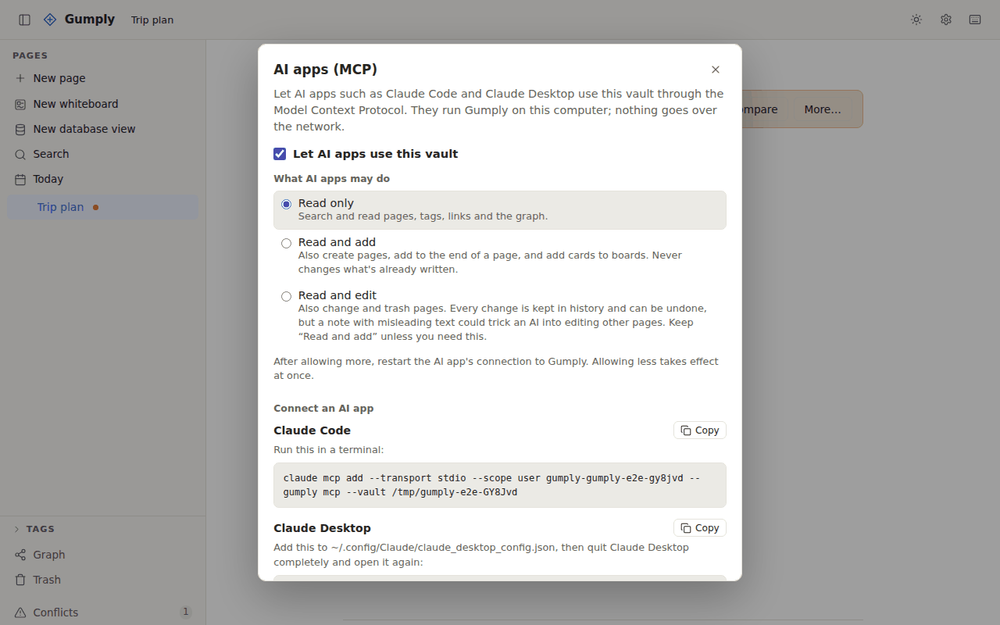

# AI apps

Let Claude Code, Claude Desktop and other AI apps that speak the Model Context Protocol (MCP) read your vault and, if you allow it, add to it. They run Gumply on your computer; nothing goes over the network.

## Turn it on

Open the gear → **AI apps (MCP)…**:

1. Turn on **Let AI apps use this vault**.
2. Choose **What AI apps may do**:
   - **Read only:** search and read pages, tags, links and the graph.
   - **Read and add** (the default): also create pages, add to the end of a page and add cards to boards. It never changes what's already written.
   - **Read and edit:** also change pages and move them to the Trash. Keep **Read and add** unless you need this.
3. Under **Connect an AI app**, copy the command for Claude Code, or the snippet for Claude Desktop, and follow the steps shown.

The full setup for each app and system, and what to do if it doesn't connect, is in [docs/mcp.md](../../mcp.md).

## See and undo what an AI app did

The same dialog lists **recent activity**: which app changed which page, and when. **Undo** on a row puts that page back the way it was before the change. Every change an AI app makes is also in the page's [version history](version-history.md), marked **AI app**.

## Good to know

- An AI app's change never overwrites what you're typing: if the page changed, its change is refused and it has to read the page again.
- A note can contain text meant to trick an AI. Read-only and Read and add keep what such text could do small.
- Raising the level asks you first. Lowering it takes effect at once.
