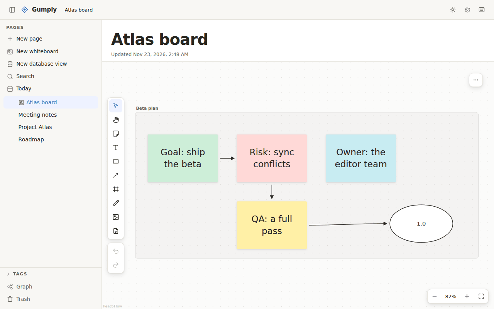

# Boards

A board is a whiteboard for stickies, shapes, text, drawings, connectors and page cards. Boards live in the sidebar next to your pages, and each one is a plain `.canvas` file that Obsidian opens too.

## Create a board

- In the sidebar, choose **New whiteboard**. Pick **Blank** or a template: Kanban, Mind map, Retrospective, Flowchart or Weekly plan.
- Inside a page: its **⋯** menu → **Add whiteboard inside**, or type `/whiteboard` in the page. The page then links to the board.
- In search (`Ctrl/Cmd+K`): **Create whiteboard “…”** or **New board from template…**.

Boards can be renamed, moved, deleted and restored like pages. They have no sub-pages.

## Add things

Choose a tool on the left, then click or drag on the board:

| Tool | Key | What it adds |
|---|---|---|
| Select | `V` | selects and moves things |
| Hand | `H` | pans the board (or hold `Space` and drag) |
| Sticky note | `N` | a coloured note; double-click the board for one too |
| Text | `T` | free text |
| Shape | `S` | a rectangle, rounded rectangle, ellipse or diamond |
| Connector | `C` | an arrow between two things; drag from one to the other |
| Frame | `F` | a named area that carries what's inside it |
| Pen | `P` | a freehand drawing |

You can also add **images and files** from the toolbar, and **page cards**: drag a page from the sidebar onto the board. A page card shows the page, and opens it when you click.

Double-click anything to write in it. Text on stickies, shapes and cards is Markdown, so `[[links]]` work: type `[[` for suggestions.

## Arrange

- **Move:** drag, or select and use the arrow keys (8 px; with `Shift`, 40 px).
- **Select several:** drag a box on an empty spot, `Shift`+click, or `Ctrl/Cmd+A` for everything.
- **Duplicate** with `Ctrl/Cmd+D`, **copy and paste** with `Ctrl/Cmd+C` and `Ctrl/Cmd+V`.
- **Bring to front / send to back:** `]` and `[`.
- **Zoom:** `Ctrl/Cmd` + scroll, or pinch. `Shift+1` fits the whole board.
<!-- TODO(#zkknytrs): once it is on main, say that zooming stays smooth on big boards (1,000+ objects). -->
- **Delete:** `Delete` or `Backspace`. `Ctrl/Cmd+Z` undoes any change; `Ctrl/Cmd+Shift+Z` redoes it.

## Use a board from the keyboard

You can do everything above without a mouse:

- **`Tab` and `Shift+Tab`** go from one object to the next, row by row, top to bottom and left to right. The object you land on is selected. Past the last one, `Tab` leaves the board.
- **`Enter`** edits the selected object's text. **`Esc`** stops editing and keeps the object selected; a second `Esc` clears the selection.
- **Arrow keys** move the selection (8 px; with `Shift`, 40 px).
- **`Delete`** deletes it; **`Ctrl/Cmd+Z`** brings it back.
- **Add an object where you are:** press a tool's key (`N`, `T`, `S` or `F`), then `Enter`. The new object appears in the middle of the view, ready for text.

With a screen reader, Gumply announces what you select, move, add and delete.

## Show a board in a page

Type `/` and choose **Embed existing board…**, or write `![[Board name.canvas]]`. The page shows a live, read-only view of the board; click it to open the board. Drag the embed's bottom edge to change its height.

## Export

The board's **⋯** menu exports the whole board, or just the selection, as **PNG** or **SVG**, on the board's background or transparent.

## Good to know

- Boards keep their **[version history](version-history.md)**. History shows an earlier version as the board itself, and **Changes** marks what was added, removed or changed since.
- A board is a [JSON Canvas](https://jsoncanvas.org) file, written the way Obsidian writes it. Sticky notes, shapes and drawings are stored as extra details Obsidian keeps but doesn't draw: in Obsidian they show as plain text cards.
- `?` lists every board shortcut.
