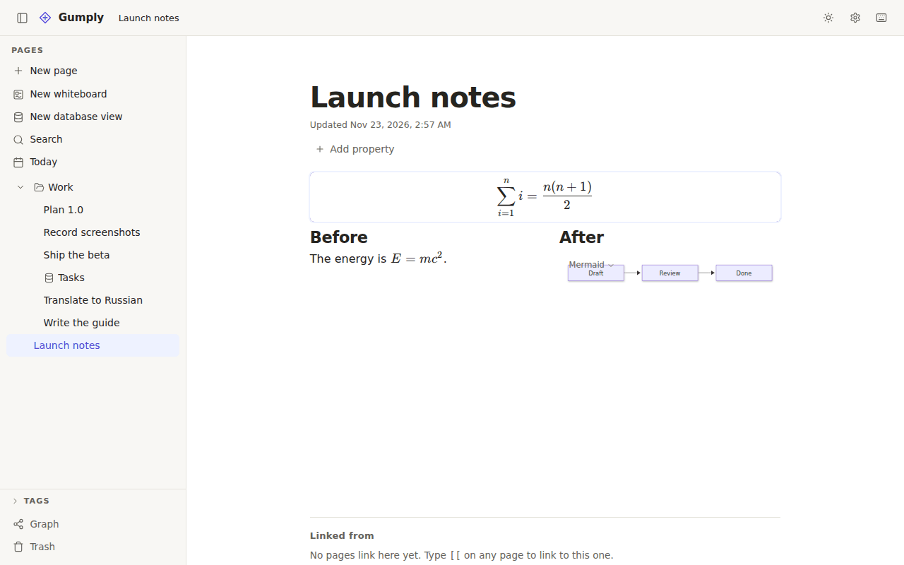

# Columns, math and diagrams



## Columns

Put blocks side by side:

- **drag a block** onto the left or right edge of another block (up to 5 columns);
- type `/columns` for 2, 3 or 4 columns, or use a block's **Turn into → Columns**;
- `Ctrl/Cmd+Alt+←` and `→` move a block to the next column.

Drag the line between two columns to resize them (each keeps at least 15%); double-click it to make them equal. A column you empty goes away. On a narrow window, columns stack one under another.

In the file, columns are written as Pandoc divs (`:::: {.columns}`), so the page stays readable Markdown. Obsidian shows the `:::` lines as text, with the columns one after another.

## Math

Formulas use LaTeX and render as you write:

- **in a line:** `$E = mc^2$`;
- **on their own line:** `$$` on one line, the formula, then `$$`. Or type `/math` (or `/equation`).

Click a formula to edit it.

## Diagrams

A code block in the language `mermaid` draws a [Mermaid](https://mermaid.js.org) diagram: a flowchart, a sequence diagram, a timeline and more. Type `/mermaid` to start one, or write:

````markdown

````

Click the diagram to edit its text.

## Good to know

- Math and diagrams show in previews and in the HTML and PDF [exports](export.md) too.
- Mermaid draws in the app, offline.
