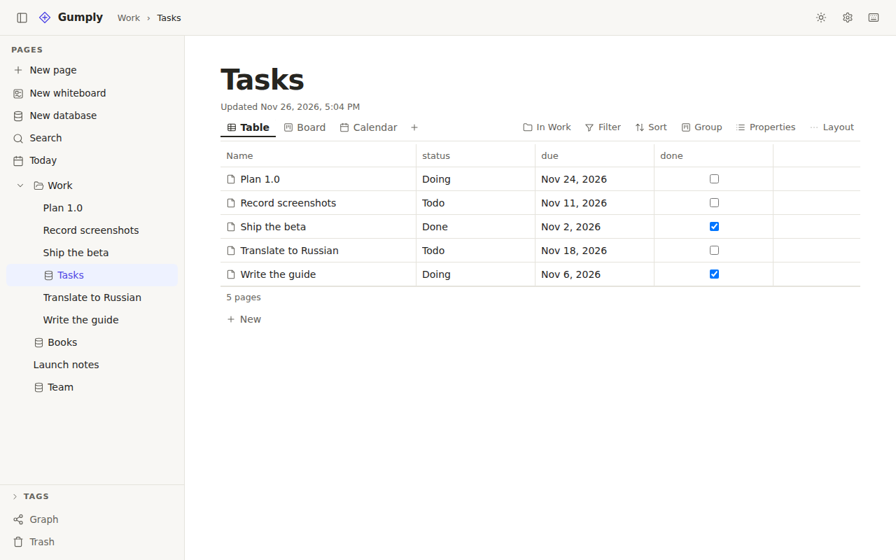
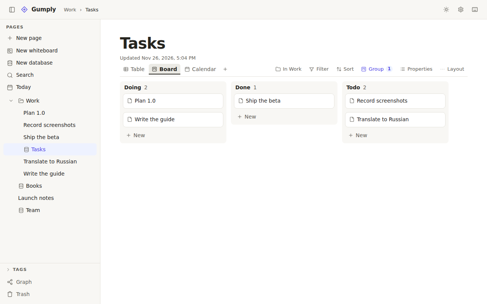
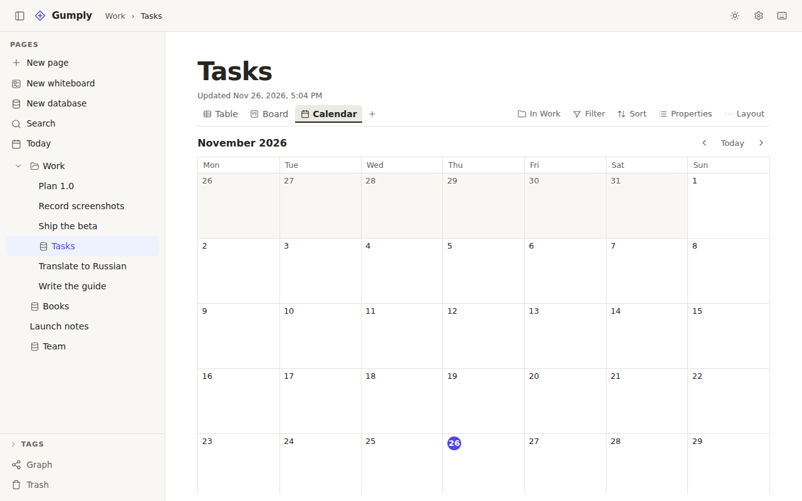

# Database views

A database view shows a set of your pages as a table, a board, a list, cards or a calendar, built from their [properties](properties-tags-templates.md). Each page stays an ordinary page; the view is a `.base` file next to them, in the same format as Obsidian's Bases.

To fill a table of your own instead, row by row or by pasting from a spreadsheet, make a [database](databases.md).

## Create a view

- In search (`Ctrl/Cmd+K`): **New view of pages…**, or **Create database view “…”** with the name you typed.
- Inside a page: its **⋯** menu → **Add view of pages inside**, or type `/database` in the page.

## Choose which pages it shows

The bar above the view sets what's in it:

- **Source:** all pages, the pages in a folder, or the pages with a tag.
- **Filter:** keep only pages whose properties match, e.g. *status is Doing* or *due is before 2026-12-01*. Add as many filters as you need.
- **Sort:** by any property, ascending or descending.
- **Properties:** which properties the view shows, and in what order.

Each view keeps its own filters, sorts and properties.

## Views

A `.base` file can hold several views. Switch between them with the tabs; **+** adds one. A tab's menu renames, duplicates or deletes it.

| View | What it shows |
|---|---|
| **Table** | one row per page, one column per property. Edit a value in place. |
| **Board** | cards in columns, grouped by a property such as *status*. Drag a card to another column to change it; **+ New** adds a page there. |
| **List** | a compact list of pages with a few properties. |
| **Cards** | a gallery, with a cover from a property or a colour. |
| **Calendar** | the pages on the dates in a date property. |

## Show a view in a page

Type `/` and choose **Embed existing database…**, or write `![[Tasks.base]]` (a specific view: `![[Tasks.base#Board]]`). The page shows the view live, and you can open the base from it.

## Good to know

- Everything you change in a view, like a status or a date, is written to that page's properties. The `.base` file holds only the view's settings.
- Gumply edits a `.base` file line by line, so Obsidian's comments and the settings it doesn't use stay as they are.
- Obsidian opens a base on its first view, and Obsidian can't show **Calendar**. If you share the base with Obsidian, put another view first.
- A view type Gumply doesn't draw yet (such as Obsidian's **Map**) stays in the file untouched; Gumply says so.
