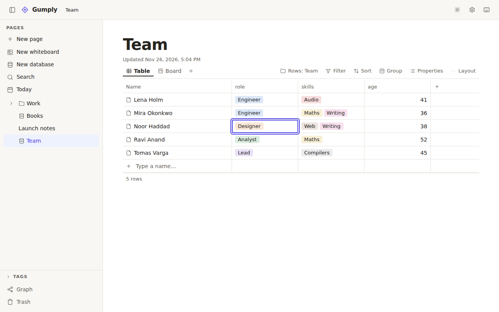
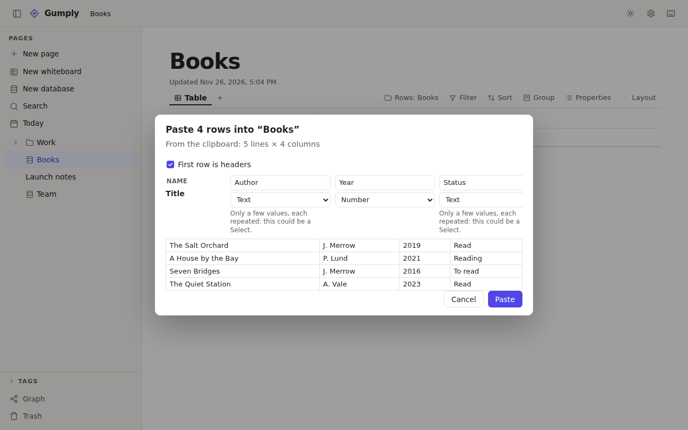
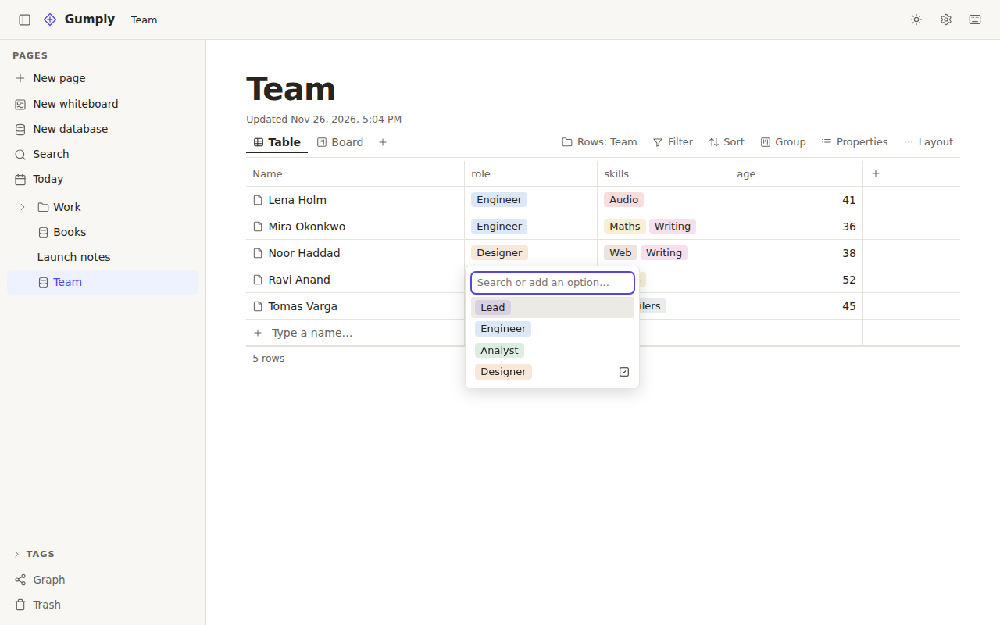
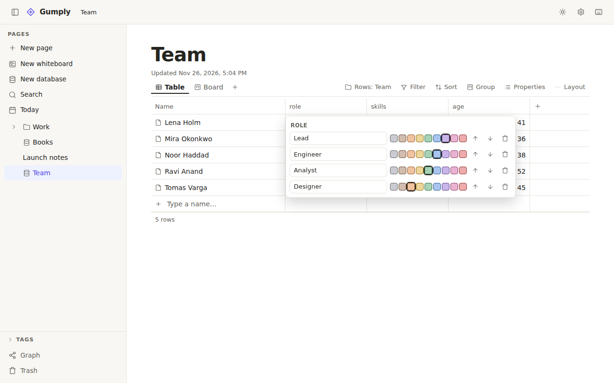
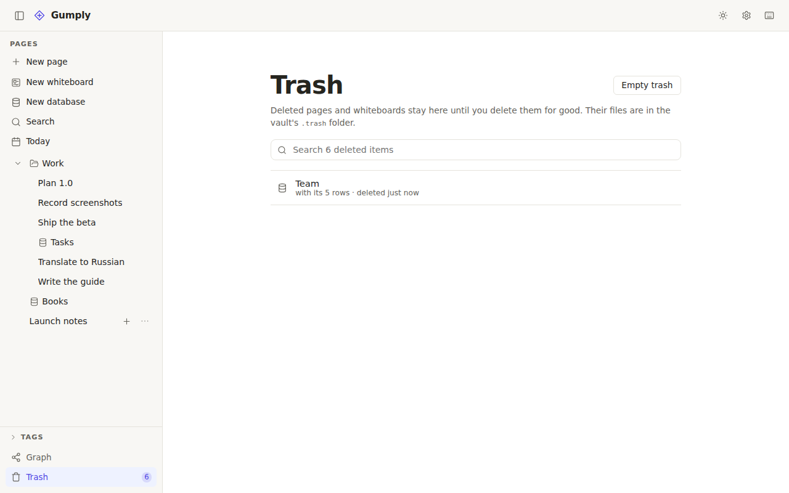

# Databases: tables of your own

A database is a table you fill yourself, like a spreadsheet or a Notion database: a list of people, books, trips or tasks. Each row is an ordinary note, so it has links, backlinks, search, the graph and its own history, and Obsidian sees the same table.

If you'd rather show pages you already have (all your notes with a tag, say), use a [database view](database-views.md) instead.

**In this chapter:** [Make one](#make-one) · [Fill it in like a spreadsheet](#fill-it-in-like-a-spreadsheet) · [Properties](#properties-the-columns) · [Paste from a spreadsheet](#paste-from-a-spreadsheet) · [Select and Multi-select](#select-and-multi-select) · [The rows folder](#the-rows-folder-in-the-sidebar) · [Undo](#undo) · [Delete and restore](#delete-and-restore) · [Good to know](#good-to-know)



## Make one

In the sidebar, choose **New database** (or search for it with `Ctrl/Cmd+K`). It's called "Untitled database" with the name ready to type: type one, such as *Team*, and press Enter.

Gumply writes two things next to each other:

```
Team.base     the table's settings: its columns, views and options
Team/         one note per row, e.g. Team/Ada Lovelace.md
```

A row's values are the note's [properties](properties-tags-templates.md), at the top of its file. The button above the table says **Rows: Team**, so you can tell a database from a view of existing pages. Clicking it opens a short note about where the rows live.

## Fill it in like a spreadsheet

**Add rows:** the last line of the table says **Type a name…**. Type a name and press **Enter** to add a row and start the next one, or **Tab** to add it and go on to its next column.

**Move around and edit:** click a cell, or use the arrow keys, to make it the *active cell* (it has an outline).

| Key | What it does |
|---|---|
| Arrows, **Tab**, **Shift+Tab** | Move to the next cell. Tab wraps to the next row. |
| Start typing | Replaces the value with what you type. |
| **Enter** | Edits the value; in the editor, Enter saves and moves down. |
| **Escape** | Cancels the edit; the cell stays active. |
| **Delete** or **Backspace** | Clears the value. |
| **Space** | Ticks or unticks a checkbox. |
| **Shift+arrows**, then **Ctrl/Cmd+C** | Copies a block of cells, to paste into a spreadsheet. |

Typing in Russian, Japanese or any other input method works the same: the first letter is never lost.

The name cell is the note's title: changing it renames the note, and links to it are updated.

## Properties (the columns)

**Add a property:** click **+** at the end of the header, type a name and choose its type: Text, Number, Checkbox, Date, Date & time, List, **Select** or **Multi-select**. If the name is already used elsewhere in your vault with another type, Gumply says so and keeps that type, so the two don't disagree.

**Change one:** click a column's header.

- **Rename** renames the property in this database's rows only. Other notes that happen to use the same name aren't touched.
- **Type** changes its type, including to **Select** or **Multi-select**: the values the rows already have become its options.
- **Delete from all rows** removes the value from every row of this database. It asks first, and each row keeps the old value in its [history](version-history.md).
- **Sort ascending**, **Sort descending** and **Hide in this view** work as in any view.

## Paste from a spreadsheet

Copy cells in Excel, Google Sheets, Numbers or a Notion table, then paste with `Ctrl/Cmd+V`:

- **One value** goes into the active cell, as if you'd typed it.
- **A block into a cell** fills down and to the right from that cell, as a spreadsheet does. Rows past the last one become new rows, named by their first column. Cells that can't go in are left out and counted under the table: a cell over the name of an existing row (a paste doesn't rename), a value that doesn't fit the property's type, or a column past the last one.
- **A block on the "Type a name…" row**, or into an empty database, opens a **preview** first.



In the preview:

- **First row is headers** is ticked when the first row looks like names.
- Each column gets a type, guessed from its values. Change any of them. A column the database already has keeps its type.
- A column with only a few values, each repeated, gets the hint *this could be a Select*. Gumply never makes it one by itself; choose **Select** to turn its values into options. A paste makes at most 200 options per column.
- More than 1,000 rows asks once more before pasting.

Commas aren't split when you paste (in "Smith, John" the comma is part of the name). For a `.csv` file, use **Import CSV…** in the database's **⋯** panel: it opens the same preview.

While a big paste runs, the table says **Pasting N rows… Other changes wait until it's done.** Your other saves are held until it ends, then they go through.

## Select and Multi-select

A Select property has a list of options, each with a colour, and shows its value as a coloured chip. A Multi-select can hold several. The options belong to this database: another database can have a "Status" with different options.



- **Choose a value:** press Enter on the cell, or start typing. The picker lists the options; type to search, then use the arrows and Enter. If nothing matches, Enter adds what you typed as a new option. A Select closes when you pick; a Multi-select stays open for the next one.
- **A value typed elsewhere** (in Obsidian, say) that isn't one of the options shows as a plain chip with a dashed border. **Add as option** makes it one.
- **Edit options…** in the column's header menu lists the options. There you can:
  - rename one: every row that has it is updated too;
  - give it another colour;
  - move it up or down;
  - delete it. Gumply asks whether to **Delete and clear from rows** or **Delete, keep the values**; kept values stay as plain chips.
- **A board grouped by a Select** shows its columns in the options' order, each with its colour, even the empty ones.



## The rows folder in the sidebar

The sidebar shows the database, not its folder of rows, so a big table doesn't fill the sidebar. The rows are still everywhere else: search, `Ctrl/Cmd+K`, links, backlinks and the graph.

To see them in the sidebar too, choose **Show rows in the sidebar** in the database's **⋯** menu. **Hide rows in the sidebar** puts it back.

## Undo

While the table is open, **Ctrl/Cmd+Z** undoes your last change to it, and **Ctrl/Cmd+Shift+Z** redoes it: a cell, a paste, a new row, a property added, renamed or deleted, an option renamed. A paste of 40 rows, or a rename across 12 rows, is one step.

**An undo can be refused.** If a row changed after your change (in another app, or by a sync), undoing would overwrite that newer text, so Gumply doesn't, and says which rows: *Can't undo: these rows changed since: …*. Nothing is written. The row's [history](version-history.md) still has every version.

Undo lasts while the table is open; reloading or closing it starts afresh. In a row's history, these changes are labelled **Database change**.

## Delete and restore

**Delete database** in its **⋯** menu asks whether to **also move its N rows to the Trash**, ticked by default. If the rows folder also holds other files (images, PDFs), it names them.

- **With its rows:** the database and its folder go to the Trash as one item, *Team, with its 6 rows*. **Restore** brings both back together.
- **Without:** only the database goes. The rows stay, as an ordinary folder the sidebar now shows.



Undoing a paste moves the rows it made to the Trash as one item, *5 rows from Team*, so you can bring them back with **Restore**.

## Good to know

- **In Obsidian**, the database is an ordinary Bases table and its folder an ordinary folder of notes. A Select's values are plain text and a Multi-select's are a list, so Obsidian's filters and boards work on them; only the colours and the picker are Gumply's.
- **Renaming or moving** the database in Gumply takes its folder along, and the other way round.
- **If another app** (Obsidian, a file manager, a sync tool) renames or moves the folder, the database no longer owns it: the table shows no rows and the folder shows in the sidebar. Nothing is lost; rename the folder back, or the database to the folder's new name.
- **A block paste** leaves out columns past the last one; to add columns, paste on the "Type a name…" row and use the preview.
- **A very big paste** holds your other saves while it runs: about 30 seconds for 3,000 rows.
- **Options** are reordered with the up and down buttons in **Edit options…**, not by dragging.
- **Rows taken out by an undo**, if you rename the database afterwards, are restored into a folder with the old name. Nothing is lost.
