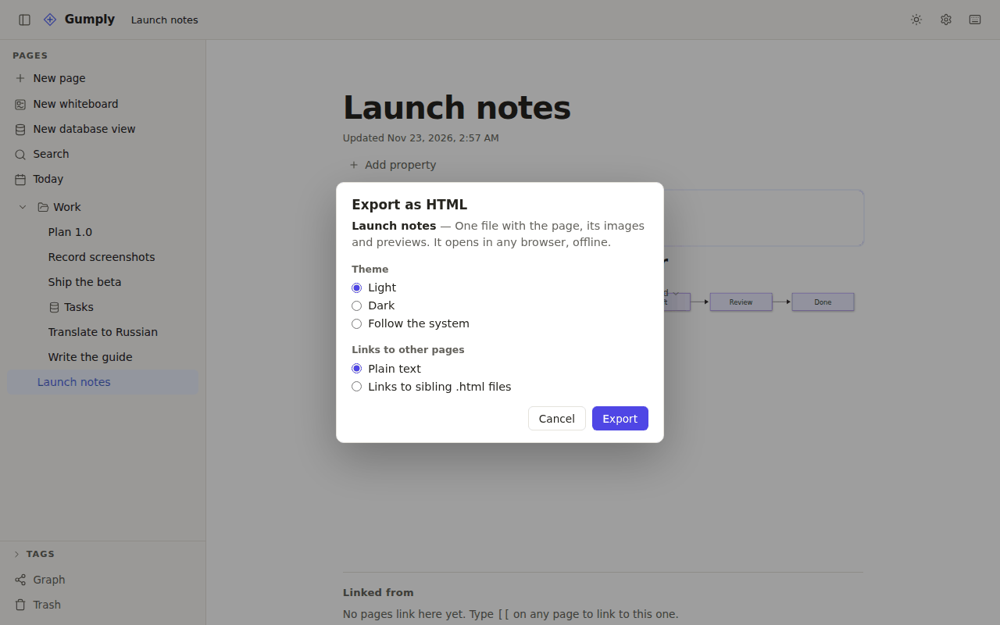

# Export as HTML or PDF

Export a page to share it with someone who doesn't use Gumply.

Open the page's **⋯** menu in the sidebar, or search (`Ctrl/Cmd+K`) for "export".

## HTML

**Export as HTML…** writes one `.html` file with everything in it: the text, images, page previews, database snapshots, math and diagrams. It opens in any browser, offline.

- **Theme:** light, dark, or the same as your system.
- **Links to other pages:** plain text, or links to `.html` files with those names next to this one (useful when you export several pages into one folder).

## PDF

**Export as PDF…** lays the page out for paper, in the light theme, with its cover, title, images, math and diagrams.

- **Paper:** A4 or Letter.
- **Margins:** normal or narrow.

The desktop app asks where to save the PDF (also from its **File** menu). In a browser, your browser's print dialog opens: choose **Save as PDF** there.

## Boards

A board exports as an image: its **⋯** menu → **PNG** or **SVG**. See [Boards](boards.md).
