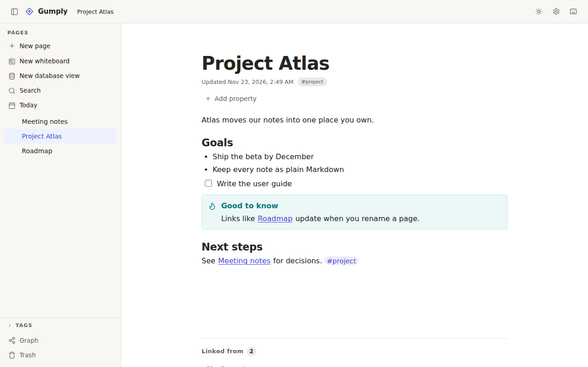

# Getting started

Gumply is a desktop app for Linux, Windows and macOS. It can also run in your browser from the source code.



## Install

Download the installer for your system from the [releases page](https://github.com/arslanarm/gumply/releases).

### Linux

- **The `.deb`** (Ubuntu, Debian): install it with `sudo apt install ./Gumply-<version>-amd64.deb`. Gumply then appears in your applications.
- **The AppImage** runs without installing. Make it executable (`chmod +x Gumply-<version>-x86_64.AppImage`) and open it. It needs FUSE 3 (`fusermount`), which Ubuntu 22.04 and later already have.

On Ubuntu 23.10 and later, the `.deb` keeps the browser sandbox that protects the app; the AppImage starts without it. Choose the `.deb` if that matters to you.

### Windows

Run `Gumply-Setup-<version>.exe`. The app isn't signed yet, so Windows asks once: choose **More info → Run anyway**.

### macOS

Open the `.dmg` (`-arm64` for Apple silicon, `-x64` for Intel) and drag Gumply to Applications. The app isn't signed yet, so macOS blocks the first start. Open **System Settings → Privacy & Security**, scroll to "Gumply was blocked…", and choose **Open Anyway**.

### In a browser, from the source

You need Node 20 or later.

```bash
npm install
npm run dev
```

Then open <http://localhost:5173>. The vault is the `vault` folder next to the code. To use another folder, start it with `GUMPLY_VAULT=/path/to/notes npm run dev`.

### Updates

On Windows and with the Linux AppImage, Gumply updates itself: it downloads a new version in the background and installs it the next time you quit. On macOS and with the `.deb`, it tells you when a new version is out. See [Settings](settings-and-shortcuts.md).

## Open or create a vault

A **vault** is the folder your notes live in. Every page is a `.md` file in it, and sub-pages live in a folder named after their page.

The first time you start Gumply, it asks you to:

- **Open a folder:** any folder of Markdown files, including an Obsidian vault;
- **Create a new vault:** an empty folder. Gumply adds a few demo notes to show you around; delete them when you like.

Later, use the **File** menu: **Open Vault…**, **Create New Vault…**, **Open Recent** and **Reveal Vault in File Manager**.

## Open an Obsidian vault as it is

Gumply reads an Obsidian vault without converting anything:

- `[[links]]`, `![[embeds]]`, headings and aliases resolve the way Obsidian resolves them;
- properties in frontmatter, with the types from `.obsidian/types.json`;
- callouts, tags, Bases (`.base`), canvases (`.canvas`), daily-note and template settings, and Banners covers;
- folders without a page of their own show as folders.

**What Gumply never does to your files:**

- it never changes text you didn't edit. When you save, only what you changed is written;
- it never adds `title:`, `created:` or `updated:` to a note that doesn't have them;
- it writes nothing into `.obsidian/`, except a property type you change yourself.

Gumply keeps its own data (version history, conflict backups) in a `.gumply` folder inside the vault. Deleted pages go to `.trash`. See [Troubleshooting](troubleshooting.md) for the full list.

## Find your way around

- **The sidebar** lists your pages and boards. Drag them to reorder or nest them. Hover a row for **+** (add a page inside) and **⋯** (more actions).
- **Search** (`Ctrl+K`, or `Cmd+K` on a Mac) finds pages by title and text, and runs commands such as "today", "template", "history" or "export". Type **>** first to list every command: for this page (rename, move, export, history…), new pages and boards, **Insert: …** and **Turn into: …** in the editor, board tools and zoom, theme, font and page width, and help.
- **`?`** shows every keyboard shortcut.
- **The gear** at the top right opens Settings: language, theme, AI apps, version history and updates.

## Next

- [Pages and blocks](pages-and-blocks.md)
- [Links and the graph](links-and-graph.md)
