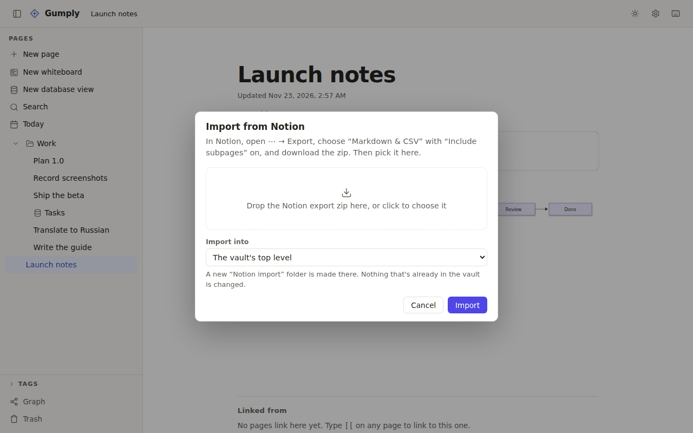

# Import from Notion

Bring a Notion workspace or page into your vault, sub-pages and databases included.

## Export from Notion

1. In Notion, open the page or workspace, then **⋯ → Export**.
2. Choose **Markdown & CSV**, and turn on **Include subpages**.
3. Download the zip.

## Import it

Choose **Import from Notion…**: in search (`Ctrl/Cmd+K`), the desktop **File** menu, or a folder's **⋯** menu (to import into that folder). Then drop the zip or choose it, and **Import**.

Everything goes into a new `Notion import` folder (`Notion import 2` the next time). **Nothing already in your vault changes.**

## What comes across

- **Pages and sub-pages**, as Gumply pages inside pages.
- **Links between pages** and **@-mentions**, as `[[links]]`.
- **Images and files**, copied to `attachments/Notion import/`.
- **Callouts** as callouts, **code blocks** with their language.
- **Databases** become a folder with one page per row. Each row's properties become typed properties: numbers, dates, checkboxes, lists, and relations as `[[links]]`. Each database also gets a [database view](database-views.md): a table in Notion's column order, plus a board if it was one in Notion.

Property types are added only for names your vault doesn't use yet; your own types always win.

## What doesn't

Notion's export doesn't include view settings, so filters, sorts, calendar and gallery views, colours and comments are left out. Formulas, rollups and people arrive as their text, and file properties as file names.

## The report

When the import finishes, Gumply shows what it converted, what it left out and why. The same report is saved as `Import report.md` in the new folder, in the app's language.
