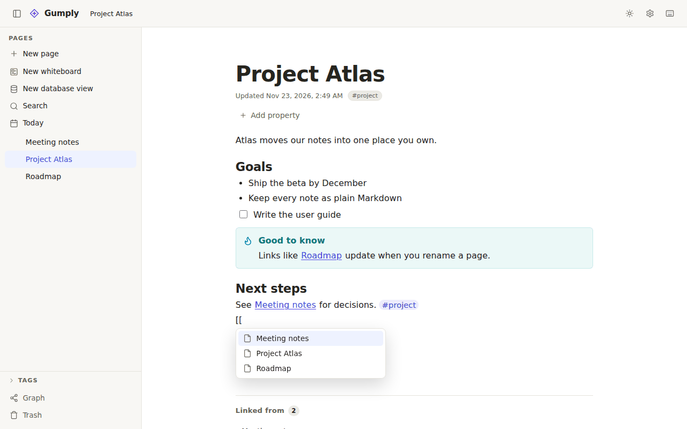
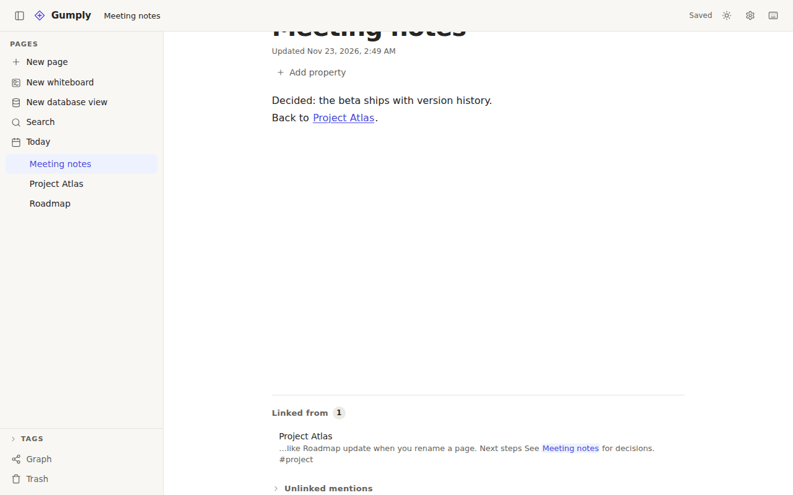
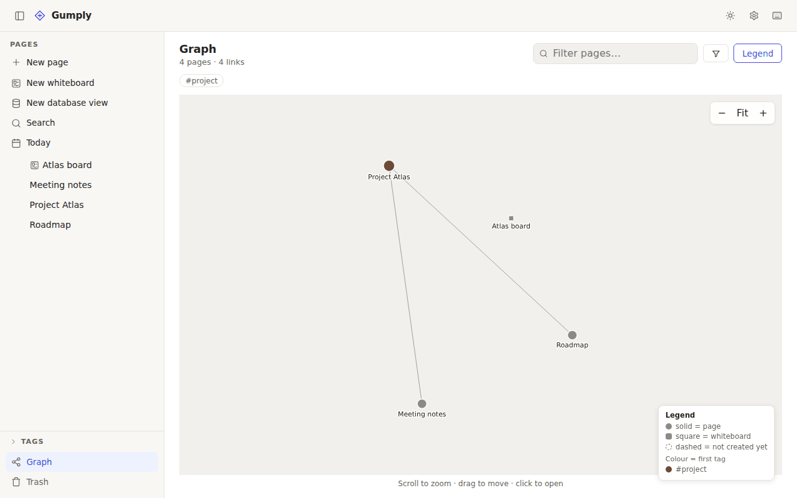

# Links and the graph

Link pages with `[[double brackets]]`, as in Obsidian. Gumply keeps links working when you rename or move pages, and shows how your pages connect.

## Link to a page

Type `[[` and start typing a title. Choose a page from the list, or **Create** a new one.

- **Show other text:** `[[Roadmap|the plan]]` shows "the plan" and opens Roadmap.
- **Link to a heading:** type `[[Roadmap#` to choose one of its headings. `[[#` lists the headings of the page you're on.
- **Embed:** `![[` embeds a file or image (anywhere in the vault), a board (`![[Plan.canvas]]`) or a database view.
- **Open a link:** click it.
- **Markdown links work too:** `[the plan](Roadmap.md)`, Obsidian's other way to write a link, opens the page and counts as a link to it everywhere below.

When several pages share a name, a link means the one in the linking page's own folder first, then the one with the shortest path, as in Obsidian. When you pick such a page from the menu, Gumply writes its path (`[[Projects/Plan|Plan]]`) so the link always means that page.

## Rename and move without breaking links

- **Rename a page:** links to it in other pages and on boards are updated to the new title, Markdown links (`[text](Old title.md)`) included, each in the form it was written in. Only the links change; nothing else in those files does.
- **Rename a heading:** links to that heading (`[[Page#Old]]`) are updated too.
- **A linking page that can't be written** (it's read-only on disk) keeps its old links. A notice names it, so you can make it writable and fix those links.
- **Move a page** to another folder: its links keep working, links to its images and files are adjusted, and Markdown links to it get its new path.
- **Renamed in another app** (Obsidian, a file manager, or a sync tool that delivers the old name's removal and the new file a few seconds apart): the sidebar shows the new name within a moment, and the links that app rewrote work as they are. If the page is open, it stays open under the new name, with anything you were typing, and its [history](version-history.md) moves with it.

## See what links here

At the bottom of every page, **Linked from** lists the pages and boards that link to it, with `[[links]]` and Markdown links alike, with the line around each link.

Below it, **Unlinked mentions** lists pages that mention this page's title (or one of its `aliases`) without linking it. Choose **Link** for one, or **Link all**.

## The graph

Choose **Graph** in the sidebar to see every page as a dot and every link as a line.

- **Bigger dots** have more links. Boards are squares. A dashed circle is a page that's linked but doesn't exist yet: click it to create it.
- **Filter** by title in the search box, or by tag with the chips under it.
- **Graph settings** (the filter button) hide or show tags, attachments, pages that don't exist yet and pages without links. **Groups** colour pages by a query such as `tag:#work` or `path:Projects`. The settings are saved per vault.
- **Move around:** scroll to zoom, drag to move, **Fit** to see it all. Click a dot to open its page.

### Forces

**Graph settings** also has **Forces**, a section you open like **Groups**, with four sliders that change how the graph arranges itself. Each is a percentage of Gumply's own layout, so **100%** leaves it as it is, at any size of vault.

| Slider | What it does | Range |
|---|---|---|
| **Center force** | How strongly every page is pulled towards the middle. At 0%, groups of pages that don't link to each other drift apart. | 0–200% |
| **Repel force** | How strongly pages push each other away. More spreads the graph out. | 0–300% |
| **Link force** | How tightly a link holds two pages together. | 0–200% |
| **Link distance** | How long a link likes to be. | 25–400% |

The graph re-arranges when you let go of a slider (or a moment after you stop pressing the arrow keys), so a big graph does it once, not at every step. **Reset forces** puts all four back to 100%. Your forces are saved per vault, like the other graph settings. Obsidian has sliders with the same names, but its values aren't read: the two apps lay out graphs differently.

### The local graph

On any page, the **Local graph** button in the header shows just that page and its neighbours, one or two links away, in a column beside the page.

### Big vaults

- **Right after opening** a vault with thousands of notes, the sidebar and your pages are there at once, while Gumply still reads the links between them. For that moment the graph and **Linked from** say **Indexing links…**, then fill in. Nothing is missing once they do.
- **A graph of more than 5,000 notes** first shows its starting layout dimmed, with **Arranging the graph… 40%** counting up, and appears once it has settled. That can take a while on a slow computer; the rest of the app stays usable meanwhile. **The next time you open the same graph**, it appears laid out at once: Gumply remembers the layout on this computer (not in your vault) until pages or links change.
- **While you zoom or move** a big graph, its lines hide for a moment and come back when you stop, so moving stays smooth.

## The outline

**Outline** (`Ctrl/Cmd+Shift+O`) lists the page's headings beside the page, or a board's frames. Click one to jump to it. It shares the side column with the local graph.

## Good to know

- Links in **properties** count too: a property whose value is `"[[Roadmap]]"` is a link, in the graph and in Linked from.
- A link to a page that doesn't exist yet is still a link. It shows dashed in the graph until you create the page.
- `\[[not a link]]` and `\[not a link](Roadmap.md)` (with a backslash) stay plain text, as in Obsidian.
- A Markdown link to a page that doesn't exist (`[x](Missing.md)`) isn't shown in the graph: it's a path, not a title.
