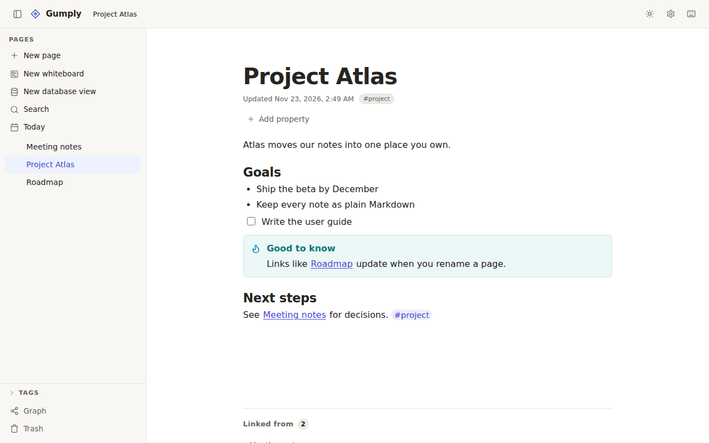
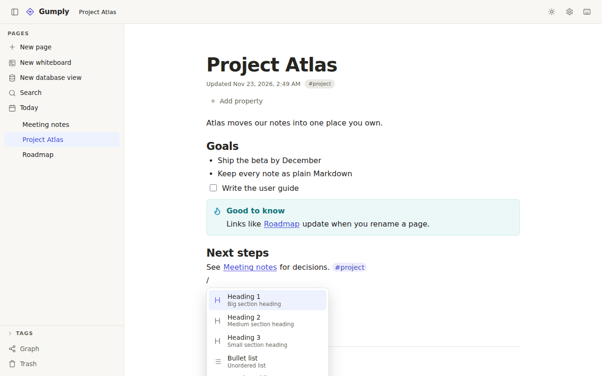

# Pages and blocks

A page is a Markdown file. What you see as blocks (paragraphs, headings, lists, callouts) are ordinary Markdown lines in that file, so the page reads the same in any other editor.



## Create a page

- In the sidebar, choose **New page**.
- To put a page inside another, hover the parent in the sidebar and choose **+**, or drag a page onto it.
- In search (`Ctrl/Cmd+K`), type a title that doesn't exist yet and choose **Create “…”**.
- Type `[[`, then a new title, and choose **Create**. You get a link to the new page.

The page's file name follows its title: "Q1 plan" is `Q1 plan.md`. Renaming the page renames the file, and links to it are updated (see [Links](links-and-graph.md)).

Press `Enter` in the title to start writing the body.

## Write with blocks

Type, and the text becomes blocks as you go:

| Type this at the start of a line | You get |
|---|---|
| `#`, `##`, `###` then a space | a heading |
| `-` then a space | a bullet list |
| `1.` then a space | a numbered list |
| `- [ ]` then a space | a to-do |
| `>` then a space | a toggle (a block that folds) |
| `"` then a space | a quote |
| ```` ``` ```` | a code block |
| `:` and a few letters | an emoji, e.g. `:rocket` |

### The `/` menu

Type `/` to insert any block: headings, lists, to-dos, quotes, callouts (note, tip, warning), toggles, code, Mermaid diagrams, math, tables, emoji, images and files, a whiteboard, a page or board template, a page preview, a database view, and dividers. Keep typing to filter the list, use the arrow keys to choose, and press `Enter`.



### Move and change blocks

Hover a block to see its handle (`⋮⋮`) on the left:

- **drag** the handle to move the block;
- **click** it for the block's actions: **Turn into** (another kind of block, or columns), **Duplicate**, **Move up / down**, **Copy link to block**, **Delete**, and more.

With the keyboard: `Ctrl/Cmd+Shift+↑/↓` moves a block up or down, and `Ctrl/Cmd+D` duplicates it.

### Format text

Select text to see the formatting toolbar: bold, italic, strikethrough, code, a link, a highlight, text and background **colours**, and **Turn into**. The usual shortcuts work too (`Ctrl/Cmd+B`, `Ctrl/Cmd+I`).

### Callouts and toggles

A **callout** is a coloured box with a title, for a note, a tip or a warning. A **toggle** is a block whose contents fold away. In the file they're Obsidian callouts (`> [!note]`), so they show the same in Obsidian. Whether a toggle starts open or closed is set in its block actions; opening one while you read never changes the file.

### Tables, images and files

- **Tables:** `/table`, then type. Hover a table's edge to add or remove rows and columns.
- **Images and files:** drag them onto the page, paste them, or use `/image` and `/file`. Gumply saves them in the vault's `attachments` folder and links them from the page.
- **Image size:** click an image, then drag the handle on either side. It snaps to a quarter, half, three quarters or the full width of the page (hold `Alt` for any width). With the image selected, `Shift+←` and `Shift+→` do the same from the keyboard. The width is saved the way Obsidian writes it (`![[pic.png|300]]`), so the image is the same size there. Move an image like any block, with `⋮⋮`, or drag the image itself.

## Give a page a look

Hover the title to add an **icon** (an emoji), a **cover** (a vault image, a colour or a gradient) or a **background** tint. They're stored as properties in the page's frontmatter.

## Delete and restore

- Delete a page from its **⋯** menu. It goes to the **Trash**, with an **Undo** button for a few seconds.
- A page with sub-pages asks first.
- **Trash** at the bottom of the sidebar lists what you deleted. **Restore** puts a page back where it was; **Delete forever** removes it and its [version history](version-history.md).

## Good to know

- Gumply saves as you type. `Ctrl/Cmd+S` saves at once.
- If another app changed the page while you were typing, Gumply doesn't overwrite it. It shows **This page changed on disk.**, with **Reload** (take theirs) and **Keep mine** (save yours and keep a backup of theirs). Either way, both versions are in the page's [history](version-history.md).
- A note without frontmatter stays without it. Gumply adds frontmatter only for something that needs it, like an icon or tags.
