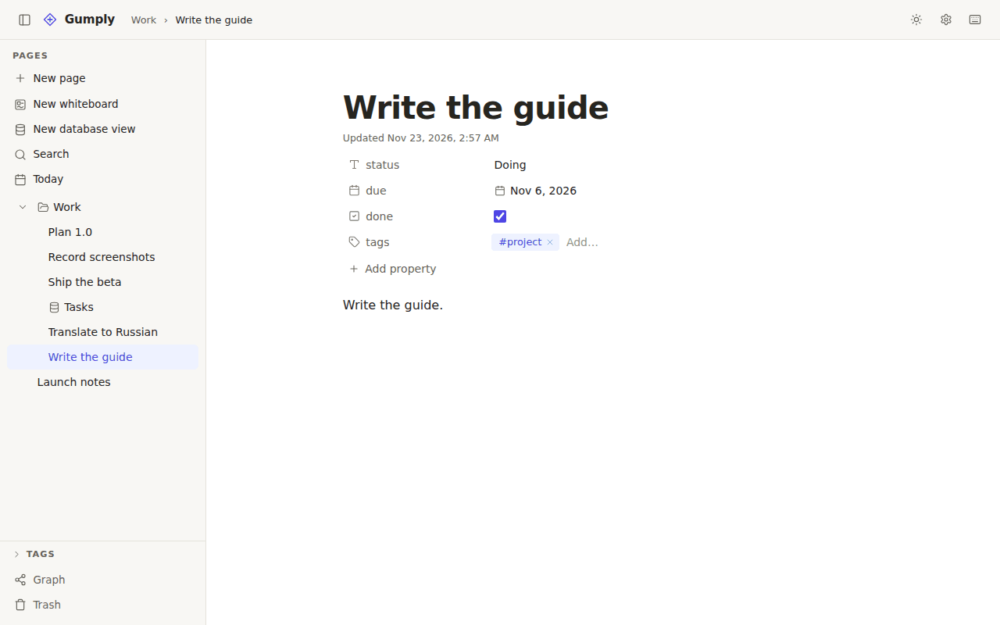

# Properties, tags and templates

## Properties

Properties are facts about a page: a status, a due date, a checkbox, a list of people. They're stored in the page's frontmatter, the YAML block at the top of the file, as in Obsidian.

- **Add one:** choose **Add property** under the title, type a name, then a value.
- **Change its type** or **rename** or **remove** it: click the property's name.
- **Types:** Text, List, Number, Checkbox, Date, Date & time, Tags and Aliases.

A type applies to every page that uses that property name. Gumply reads and writes types where Obsidian keeps them, in `.obsidian/types.json`. A vault without an `.obsidian` folder keeps them in `.gumply/types.json`.

When you edit a property, only that line changes in the file. Keys you don't use, comments and the order of lines stay as they are.

Properties feed [database views](database-views.md), and a property whose value is a `[[link]]` counts as a [link](links-and-graph.md).

## Tags

Tag a page in two ways:

- in the text: `#project`, or nested, `#project/atlas`;
- in the **tags** property.

The **Tags** section at the bottom of the sidebar lists every tag with how many pages use it. Click a tag to find its pages; a nested tag also finds the tags under it.

**Rename a tag:** hover it in the Tags section and choose **✎**, or right-click it. Gumply renames it everywhere: in text and in properties, nested tags included. Only the tags change.

Tags follow Obsidian's rules. `#2024` alone isn't a tag (a tag needs a letter), and tags inside code, links and URLs don't count. If a page writes `tags: a, b` as text, Gumply shows the tags with a warning that Obsidian won't read them, and **Make it a list** fixes just that line.

## Page templates

A template is an ordinary page in your templates folder: `Templates` by default, or the folder set in Obsidian's Templates plugin.

- **New page from a template:** in search (`Ctrl/Cmd+K`), **New page from template…**, or a page's **⋯** menu → **New page from template…** to put it inside that page.
- **Insert a template into a page:** type `/template`.

In a template, `{{title}}` becomes the new page's title, and `{{date}}` and `{{time}}` the current date and time, in the formats from Obsidian's Templates settings.

Board templates (Kanban, Mind map and others) are covered in [Boards](boards.md).
