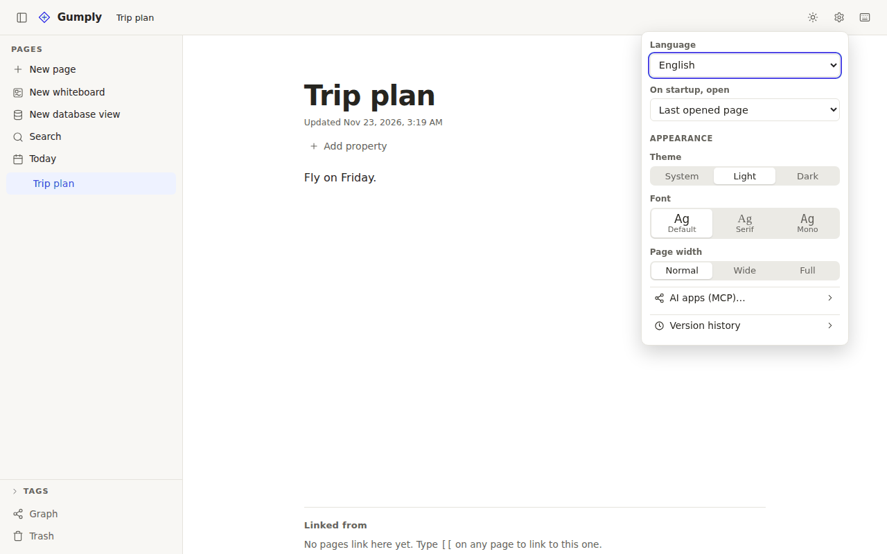
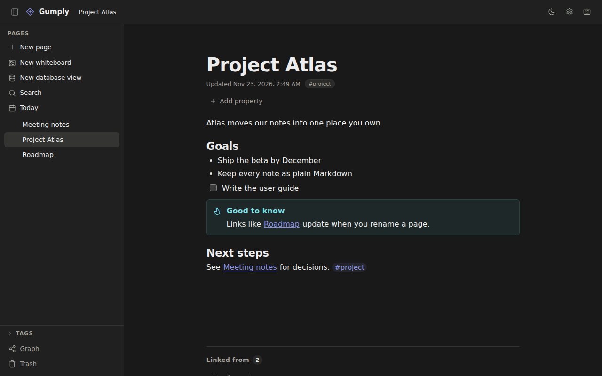
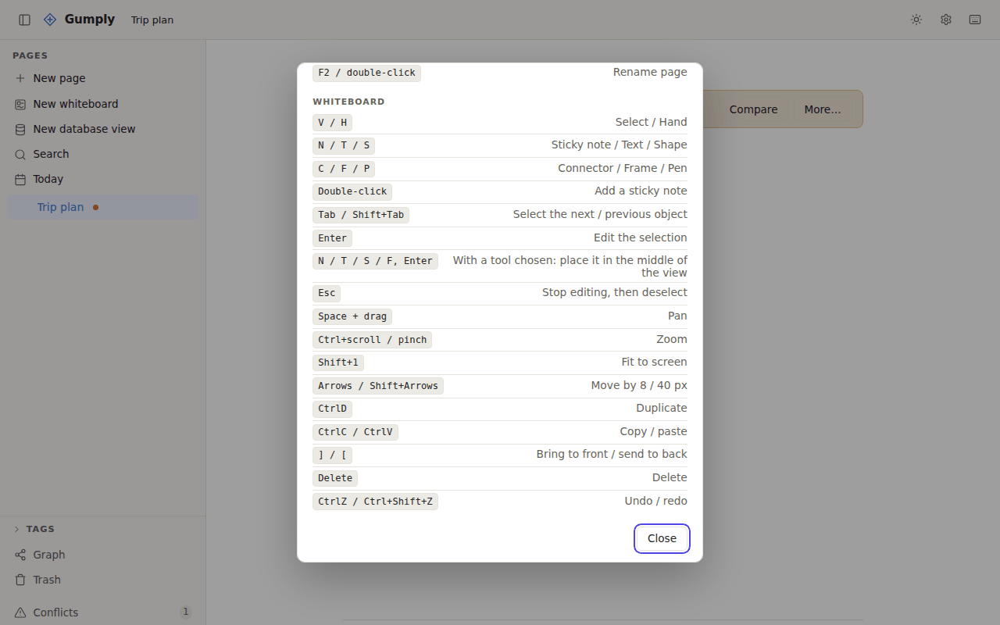

# Settings and keyboard shortcuts

## Settings

Open them with the gear at the top right.



- **Language:** English or Russian, or the same as your system. Menus in the desktop app follow it.
- **On startup, open:** the **Last opened page**, **A page I choose** (pick it with **Choose…**), or **Today's daily note**.
- **Appearance:**
  - **Theme:** System, Light or Dark. The sun or moon button next to the gear switches it too.
  - **Font** for your pages: **Default**, **Serif** or **Mono**.
  - **Page width:** **Normal**, **Wide**, or **Full** (the whole window).
- **AI apps (MCP)…:** let AI apps use this vault. See [AI apps](ai-apps.md).
- **Version history:** how much space it takes, clearing old versions, and the lines for Syncthing. See [Version history](version-history.md).
- **Updates…** (desktop app only): what Gumply does when there's a new version:
  - **Download and install updates automatically** (Windows and the Linux AppImage): Gumply downloads it in the background and installs it the next time you quit. Nothing restarts without you; **Restart now** installs it at once.
  - **Only tell me when there's a new version** (always the case on macOS and with the `.deb`).
  - **Don't check for updates.**
  - **Check now.** A check asks GitHub for the latest release; GitHub sees your IP address, and nothing else is sent.



Settings are kept per device: in the desktop app, in your user settings folder; in a browser, in the browser. They're never stored in your vault.

## Keyboard shortcuts

Press `?` anywhere (outside a text field) to see them all. `Ctrl` is `Cmd` on a Mac.



### Move around

| Keys | Does |
|---|---|
| `Ctrl+K` | Search pages and run commands |
| `Ctrl+\` | Show or hide the sidebar |
| `Ctrl+Shift+D` | Open today's note |
| `Ctrl+Shift+O` (or `Ctrl+Alt+O`) | Show or hide the outline |
| `?` | All keyboard shortcuts |

### Write

| Keys | Does |
|---|---|
| `/` | Insert a block |
| `[[` | Link a page |
| `#` `##` `###` then a space | Heading |
| `-` / `1.` / `- [ ]` then a space | Bullet list / numbered list / to-do |
| `>` then a space | Toggle |
| `"` then a space | Quote |
| ```` ``` ```` | Code block |
| `Ctrl+B` / `Ctrl+I` / `Ctrl+E` | Bold / italic / inline code |
| `Ctrl+Shift+S` / `Ctrl+Shift+H` | Strikethrough / highlight |
| `Ctrl+Z` | Undo |
| `Ctrl+S` | Save now |
| `Ctrl+Shift+↑ / ↓` | Move the block up or down |
| `Ctrl+D` | Duplicate the block |
| `Ctrl+Alt+← / →` | Move a block to the next column |

### Pages

| Keys | Does |
|---|---|
| `Enter` in the title | Go to the page's text |
| `F2`, or double-click in the sidebar | Rename the page |
| `Shift+F10` or the menu key on a sidebar row | Open the row's menu |

### Boards

| Keys | Does |
|---|---|
| `V` / `H` | Select / hand |
| `N` / `T` / `S` | Sticky note / text / shape |
| `C` / `F` / `P` | Connector / frame / pen |
| `Tab` / `Shift+Tab` | Select the next / previous object |
| `Enter` | Edit the selection |
| a tool key, then `Enter` | Place it in the middle of the view |
| `Esc` | Stop editing, then deselect |
| Double-click | Add a sticky note |
| `Space` + drag | Pan |
| `Ctrl` + scroll, or pinch | Zoom |
| `Shift+1` | Fit to screen |
| Arrows / `Shift`+arrows | Move by 8 / 40 px |
| `Ctrl+D` | Duplicate |
| `Ctrl+C` / `Ctrl+V` | Copy / paste |
| `]` / `[` | Bring to front / send to back |
| `Delete` | Delete |
| `Ctrl+Z` / `Ctrl+Shift+Z` | Undo / redo |
