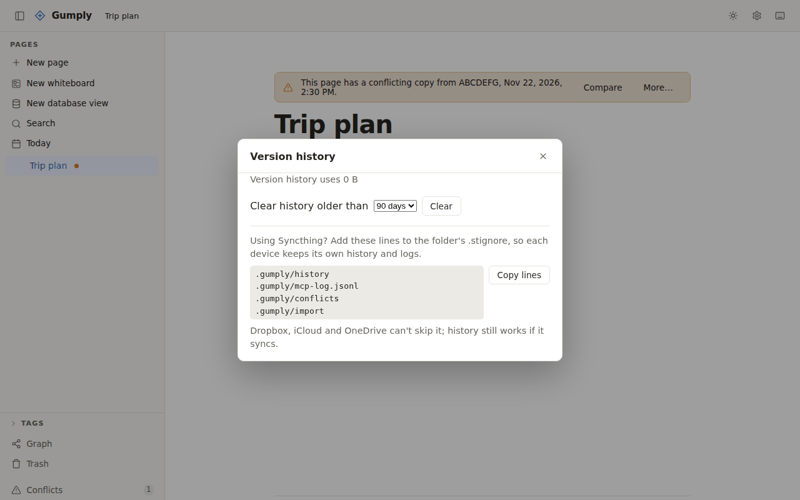
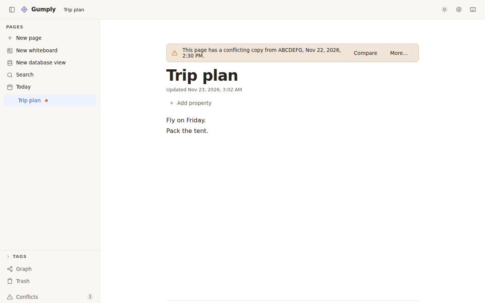
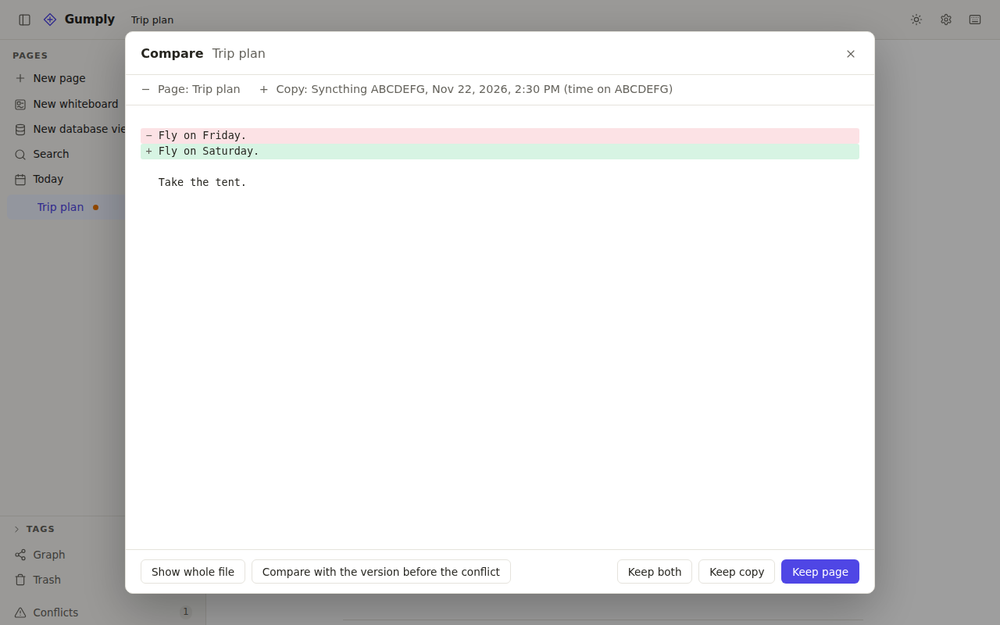
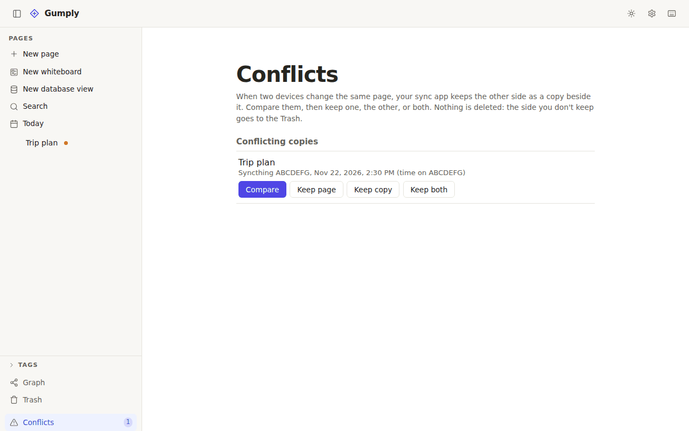

# Sync with other apps

Gumply has no sync of its own. Your vault is a folder, so you can keep it in sync between devices with the tool you already use: Syncthing, Dropbox, iCloud Drive, OneDrive, Nextcloud, Yandex Disk, Obsidian Sync or git.

## Set it up

1. Put the vault folder (or open a vault that's already) in the synced folder.
2. **Syncthing:** add a few lines to the folder's `.stignore`, so each device keeps its own version history and Gumply's working files don't travel. Gumply gives you the lines: the gear → **Version history** → **Copy lines**. Gumply never writes `.stignore` itself.

```
.gumply/history
.gumply/mcp-log.jsonl
.gumply/conflicts
.gumply/import
```

Dropbox, iCloud and OneDrive can't skip a folder. That's fine: history still works if it syncs.



## When two devices change the same page

If you edit a page on two devices before they sync, your sync tool keeps the other side as a **conflicting copy** next to the page, e.g. `Trip plan.sync-conflict-20261122-143005-ABCDEFG.md`. Gumply recognises copies from Syncthing, Dropbox, Nextcloud, Yandex Disk (`Trip plan (копия с компьютера Laptop).md`) and Obsidian Sync, and:

- **hides the copy** from the sidebar, and marks the page with an orange dot;
- shows a **banner** on the page: who made the copy and when, with **Compare**;
- lists every conflict under **Conflicts**, at the bottom of the sidebar (only while there are any), and in search: **Show conflicts**.



### Compare, then keep one or both

**Compare** shows the page and the copy side by side, with the differences marked.



Then choose:

- **Keep page:** the copy goes to the Trash.
- **Keep copy:** the copy's text replaces the page. The page's old text stays in its [version history](version-history.md).
- **Keep both:** the copy becomes its own page, named `<title> (copy <date>)`.

Each choice can be undone from the message that follows it. Nothing is written until you choose, and if either file changes while you compare, Gumply asks you to check again.



### Possible copies

iCloud, OneDrive and Google Drive name their copies like ordinary pages (`Trip plan 2`, `Trip plan-Laptop`, `Trip plan (1)`), so Gumply can't be sure. When such a page has mostly the same text as a page beside it, it's listed under **Possible copies** in Conflicts, with **Compare** and **Not a copy**.

## Good to know

- A copy you open from search or a link is **read-only**, so it never becomes a third version.
- Copies don't appear in the graph, backlinks, tags or database views. Search finds them, marked **Conflicting copy**.
- When many files change at once (a sync, a `git checkout`), the sidebar shows **Syncing changes…** until Gumply has caught up. Your own saves come first.
- **A page renamed on another device** arrives as one file removed and another one added, sometimes a few seconds apart. Gumply recognises it as the same page renamed, so you don't get a duplicate that comes back, and its [history](version-history.md) follows it.
- **A change that keeps the file's size and time** (some sync tools and memory cards round file times to 2 seconds) is still noticed: an open page shows the new text, and a save from before it is never written over it (see ["This page changed on disk"](troubleshooting.md)).
- Conflicting copies of images and other files are listed, but you resolve those in your file manager.
- Which of Gumply's files are safe to sync or delete, and every name it recognises as a conflicting copy: [Gumply's file format](../../file-format.md).
