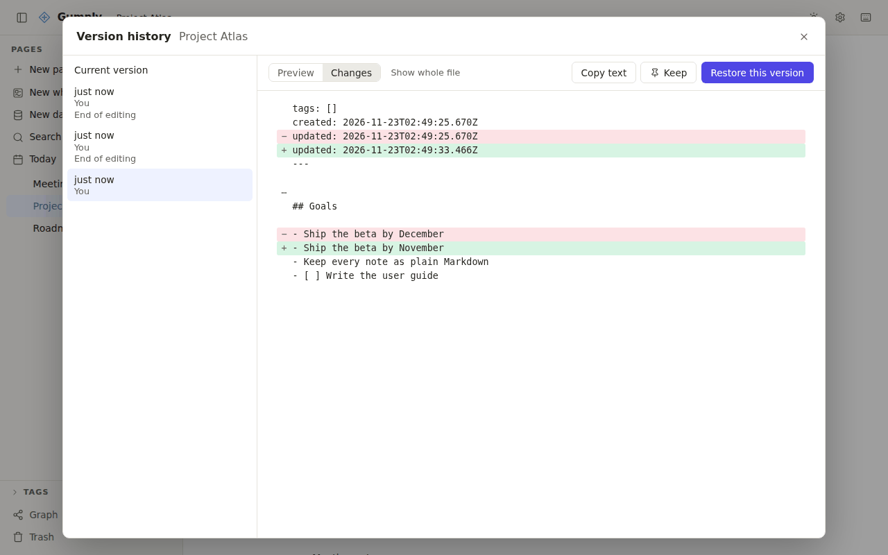

# Version history

Gumply keeps earlier versions of every page and board. You can see who changed what and when, compare a version with now, and restore it. Restoring can be undone.

## Open the history

- In the sidebar, the page's **⋯** menu → **History…**
- Or search (`Ctrl/Cmd+K`) → **Show page history**, for the page or board you have open.

**On the left**, the versions, newest first. Each one says when it was made and by whom:

- **You:** saved by you in Gumply. **End of editing** marks the last state of an editing session.
- **Outside edit:** another app changed the file (Obsidian, a text editor, git, a sync tool).
- **AI app (…):** an AI app changed it through [Gumply's MCP server](ai-apps.md).
- **Notion import**, **Before restore**, and **Renamed from / Moved from** when the page had another name or folder then.

**On the right**, the selected version:

- **Preview** shows it as the page looked then. For a board, it's the board itself; you can pan and zoom it.
- **Changes** shows what's different from now: added lines in green with **+**, removed lines in red with **−**. **Show whole file** shows the lines around them too. For a board, Changes marks cards added (green outline), removed (faded, dashed red) and changed (amber), with a list of those cards below.

## Restore a version

Select it and choose **Restore this version**. The page gets that version's text back, exactly as it was, and keeps its current name and place. If the version had another title, a note above it says so.

**Undo a restore:** the version just before it is at the top of the list, as **Before restore**. Restore that one.

If the page changed in another app while you were looking, Gumply asks you to check the list again instead of overwriting the change.

## Keep a version

**Keep** marks a version so it's never cleaned up. Kept versions show a pin in the list.

## When versions are made

- **While you type:** at most one version every 5 minutes, so a long session doesn't fill the list.
- **When you stop:** after 10 minutes without typing, when you open another page, or when you quit, your last state is kept as **End of editing**.
- **When another app changes the file:** what you last saved here and what the other app wrote are both kept.
- **When a page goes to the Trash.**

**How long they're kept:** every version for a day, then one per hour for a week, then one per day for 90 days. The newest version and the ones you keep always stay.

## Deleted pages

- **In the Trash:** restore the page first (**Trash → Restore**); its history comes back with it.
- **Delete forever** and **Empty trash** delete the page's history too.
- A page deleted in another app (or renamed there in a way Gumply can't match) keeps its history in **Trash → Earlier versions of deleted pages**. **Restore as a page** brings it back.

## Settings → Version history

The gear → **Version history** shows how much space history takes, and can **clear history older than** 7, 30 or 90 days. If you sync your vault with Syncthing, it gives you the lines to add to `.stignore`, so each device keeps its own history (see [Sync with other apps](sync-with-other-apps.md)).

## Good to know

- **A page you've only viewed here has no version from before another app changes it.** Gumply keeps what it saves and what it sees change. A note you never edited in Gumply gets its first version when something changes it.
- History never changes your notes. It's kept as plain files under `.gumply/history` in the vault, at most 200 MB or half the vault's size, whichever is larger.
- `.base` files (database views) and attachments have no history.
