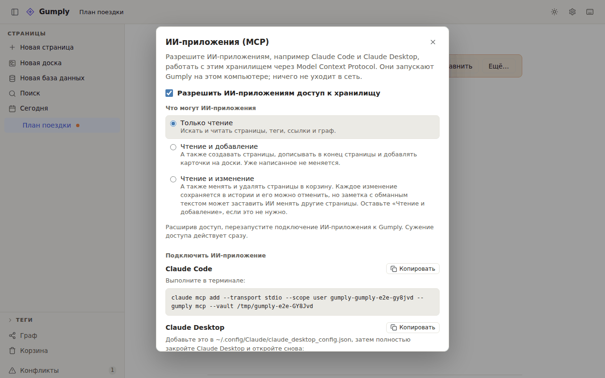

# ИИ-приложения

Разрешите Claude Code, Claude Desktop и другим ИИ-приложениям, которые работают по протоколу Model Context Protocol (MCP), читать ваше хранилище и — если вы позволите — дополнять его. Они запускают Gumply на вашем компьютере; ничего не уходит в сеть.

## Включить

Откройте шестерёнку → **ИИ-приложения (MCP)…**:

1. Включите **Разрешить ИИ-приложениям доступ к хранилищу**.
2. Выберите, **что могут ИИ-приложения**:
   - **Только чтение:** искать и читать страницы, теги, ссылки и граф.
   - **Чтение и добавление** (по умолчанию): ещё создавать страницы, дописывать в конец страницы и добавлять карточки на доски. Уже написанное не меняется.
   - **Чтение и изменение:** ещё менять страницы и переносить их в Корзину. Оставьте «Чтение и добавление», если это не нужно.
3. В разделе **Подключить ИИ-приложение** скопируйте команду для Claude Code или фрагмент для Claude Desktop и выполните показанные шаги.

Подробная настройка для каждого приложения и системы, а также что делать, если подключиться не получается, — в [docs/mcp.md](../../mcp.md) (на английском).

## Что сделало ИИ-приложение, и как это отменить

В том же окне есть **последние действия**: какое приложение какую страницу изменило и когда. **Отменить** в строке возвращает страницу к виду до этого изменения. Каждое изменение ИИ-приложения есть и в [истории версий](version-history.md) страницы — с пометкой **ИИ-приложение**.

## Полезно знать

- Изменение от ИИ-приложения никогда не перезапишет то, что вы печатаете: если страница изменилась, изменение отклоняется, и приложению нужно прочитать страницу заново.
- В заметке может оказаться текст, написанный, чтобы обмануть ИИ. Уровни «Только чтение» и «Чтение и добавление» ограничивают, что такой текст может натворить.
- Повышение уровня Gumply сначала подтверждает у вас. Понижение действует сразу.
