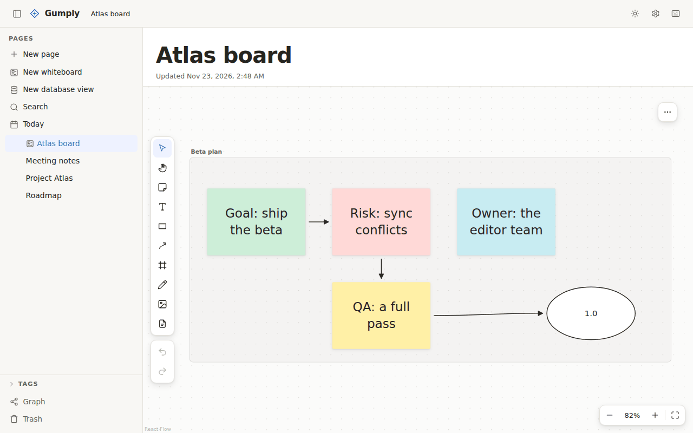

# Доски

Доска — это холст для стикеров, фигур, текста, рисунков, соединителей и карточек страниц. Доски лежат в боковой панели рядом со страницами, и каждая — обычный файл `.canvas`, который открывается и в Obsidian.

## Создать доску

- В боковой панели выберите **Новая доска**. Выберите **Пустая** или шаблон: канбан, карту мыслей, ретроспективу, блок-схему или план на неделю.
- Внутри страницы: её меню **⋯** → **Добавить доску внутрь** или `/доска` на самой странице. Страница получит ссылку на доску.
- В поиске (`Ctrl/Cmd+K`): **Создать доску «…»** или **Новая доска из шаблона…**.

Доски можно переименовывать, перемещать, удалять и восстанавливать, как страницы. Подстраниц у досок нет.

## Что можно добавить

Выберите инструмент слева, затем щёлкните или протяните мышью по доске:

| Инструмент | Клавиша | Что добавляет |
|---|---|---|
| Выделение | `V` | выделяет и двигает объекты |
| Рука | `H` | двигает доску (или зажмите `Пробел` и тяните) |
| Стикер | `N` | цветную заметку; двойной щелчок по доске тоже её создаёт |
| Текст | `T` | свободный текст |
| Фигура | `S` | прямоугольник, скруглённый прямоугольник, эллипс или ромб |
| Соединитель | `C` | стрелку между двумя объектами: протяните от одного к другому |
| Фрейм | `F` | именованную область, которая носит с собой всё, что внутри |
| Перо | `P` | рисунок от руки |

С панели инструментов можно добавить и **изображения и файлы**, а **карточку страницы** — перетащив страницу из боковой панели на доску. Карточка показывает страницу и открывает её по щелчку.

Дважды щёлкните по объекту, чтобы писать в нём. Текст на стикерах, фигурах и карточках — это Markdown, поэтому `[[ссылки]]` работают: наберите `[[`, чтобы увидеть подсказки.

## Расположение

- **Двигать:** перетаскивайте или выделите объект и нажимайте стрелки (8 px; с `Shift` — 40 px).
- **Выделить несколько:** обведите рамкой пустое место, щёлкните с `Shift` или нажмите `Ctrl/Cmd+A`, чтобы выделить всё.
- **Дублировать** — `Ctrl/Cmd+D`, **копировать и вставить** — `Ctrl/Cmd+C` и `Ctrl/Cmd+V`.
- **На передний / на задний план:** `]` и `[`.
- **Масштаб:** `Ctrl/Cmd` + колесо или щипок. `Shift+1` показывает всю доску.
<!-- TODO(#zkknytrs): once it is on main, say that zooming stays smooth on big boards (1,000+ objects). -->
- **Удалить:** `Delete` или `Backspace`. `Ctrl/Cmd+Z` отменяет любое изменение, `Ctrl/Cmd+Shift+Z` повторяет его.

## Доска с клавиатуры

Всё, что описано выше, можно делать без мыши:

- **`Tab` и `Shift+Tab`** переходят от объекта к объекту — по строкам, сверху вниз и слева направо. Объект, на который вы попали, выделяется. После последнего `Tab` уводит с доски.
- **`Enter`** открывает текст выделенного объекта для правки. **`Esc`** заканчивает правку, а объект остаётся выделенным; второй `Esc` снимает выделение.
- **Стрелки** двигают выделенное (8 px; с `Shift` — 40 px).
- **`Delete`** удаляет его; **`Ctrl/Cmd+Z`** возвращает.
- **Добавить объект там, где вы сейчас:** нажмите клавишу инструмента (`N`, `T`, `S` или `F`), затем `Enter`. Новый объект появится в центре вида, сразу готовый для текста.

С программой чтения с экрана Gumply сообщает, что вы выделили, сдвинули, добавили и удалили.

## Доска на странице

Наберите `/` и выберите **Встроить доску…** или напишите `![[Название доски.canvas]]`. Страница покажет живой вид доски только для просмотра; нажмите на него, чтобы открыть доску. Потяните за нижний край, чтобы изменить высоту.

## Экспорт

Меню доски **⋯** экспортирует всю доску или только выделенное в **PNG** или **SVG** — на фоне доски или с прозрачным фоном.

## Полезно знать

- У досок тоже есть **[история версий](version-history.md)**. Прежняя версия показывается как сама доска, а **Изменения** отмечают, что с тех пор добавлено, удалено или изменено.
- Доска — это файл [JSON Canvas](https://jsoncanvas.org), записанный так же, как его пишет Obsidian. Стикеры, фигуры и рисунки хранятся как дополнительные данные, которые Obsidian сохраняет, но не рисует: в Obsidian они выглядят как обычные текстовые карточки.
- `?` показывает все сочетания клавиш для досок.
