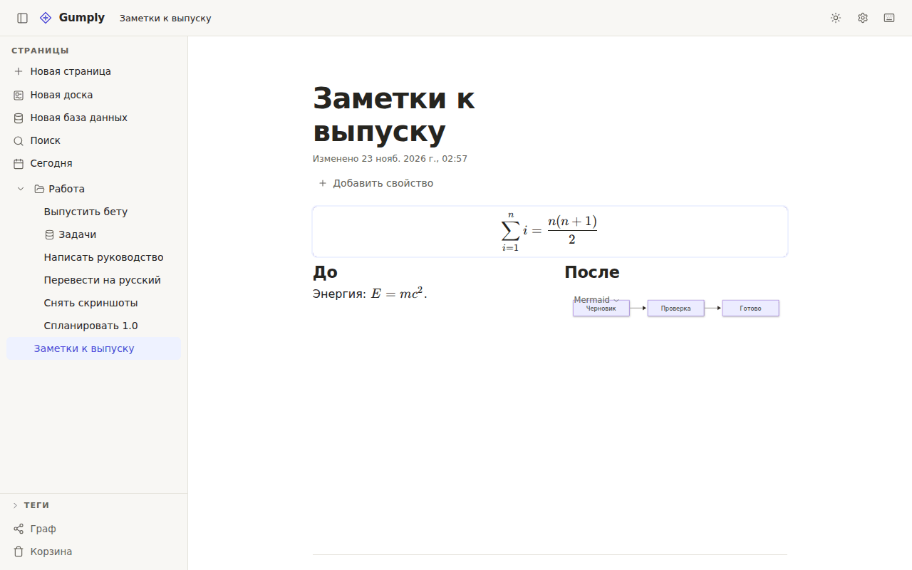

# Колонки, формулы и диаграммы



## Колонки

Ставьте блоки рядом:

- **перетащите блок** на левый или правый край другого блока (до 5 колонок);
- наберите `/колонки` (или `/columns`) — получится 2, 3 или 4 колонки, — или выберите в действиях блока **Превратить в → Колонки**;
- `Ctrl/Cmd+Alt+←` и `→` переносят блок в соседнюю колонку.

Потяните линию между колонками, чтобы поменять ширину (каждая колонка — не уже 15%); двойной щелчок по ней выравнивает колонки. Опустевшая колонка исчезает. В узком окне колонки встают одна под другой.

В файле колонки записаны как блоки Pandoc (`:::: {.columns}`), поэтому страница остаётся читаемым Markdown. Obsidian показывает строки `:::` как текст, а колонки — одну за другой.

## Формулы

Формулы пишутся на LaTeX и отображаются прямо при наборе:

- **в строке:** `$E = mc^2$`;
- **отдельной строкой:** `$$` на одной строке, затем формула, затем `$$`. Или наберите `/формула`.

Нажмите на формулу, чтобы её отредактировать.

## Диаграммы

Блок кода на языке `mermaid` рисует диаграмму [Mermaid](https://mermaid.js.org): блок-схему, диаграмму последовательности, временную шкалу и другие. Наберите `/диаграмма`, чтобы начать, или напишите:

````markdown

````

Нажмите на диаграмму, чтобы отредактировать её текст.

## Полезно знать

- Формулы и диаграммы видны и в превью, и в [экспорте](export.md) в HTML и PDF.
- Mermaid рисует прямо в приложении, без сети.
