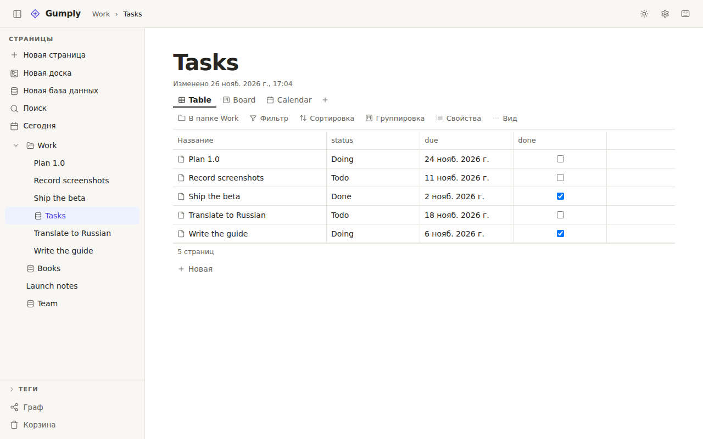
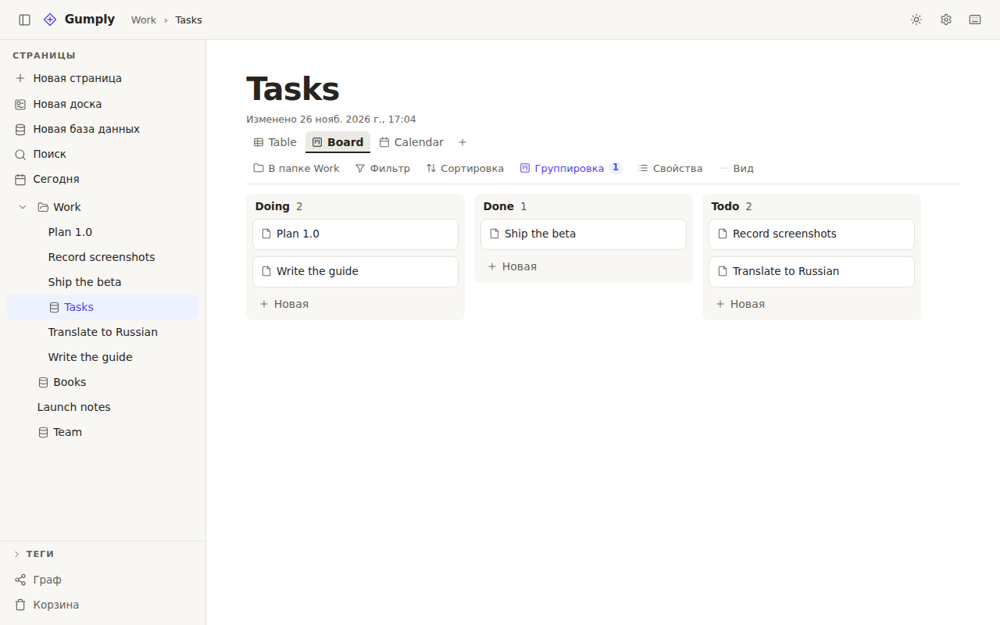
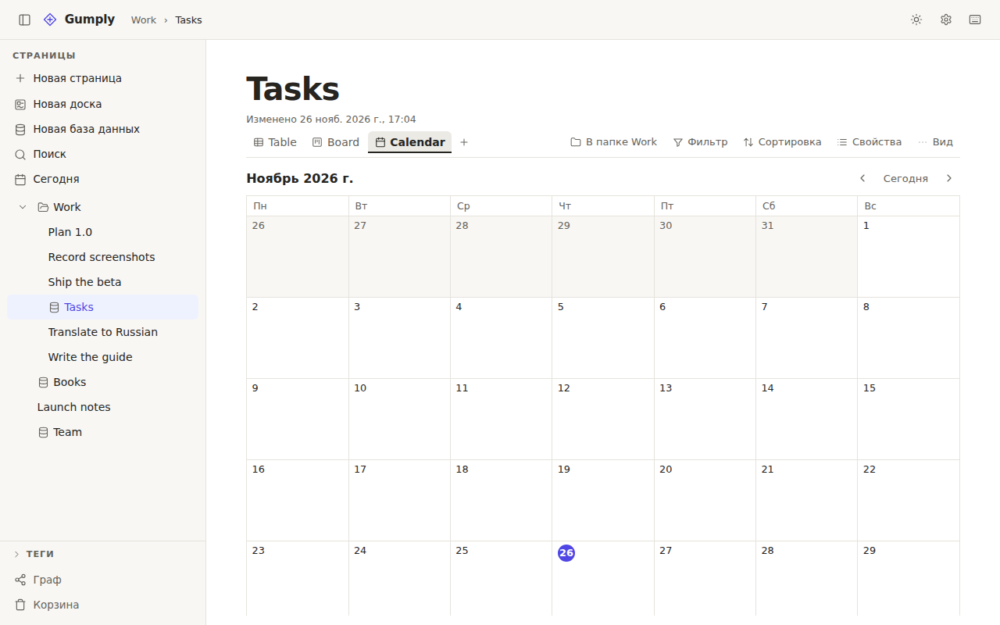

# Представления страниц

Представление показывает набор ваших страниц как таблицу, доску, список, карточки или календарь — по их [свойствам](properties-tags-templates.md). Каждая страница остаётся обычной страницей, а сама база — это файл `.base` рядом с ними, в том же формате, что и базы Obsidian (Bases).

Чтобы заполнять свою таблицу — строку за строкой или вставкой из электронной таблицы, — создайте [базу данных](databases.md).

## Создать представление

- В поиске (`Ctrl/Cmd+K`): **Новое представление страниц…** или **Создать базу данных «…»** с введённым названием.
- Внутри страницы: её меню **⋯** → **Добавить представление внутрь** или `/база` на самой странице.

## Какие страницы в ней

Панель над базой задаёт, что в неё попадает:

- **Источник:** все страницы, страницы в папке или страницы с тегом.
- **Фильтр:** только страницы, чьи свойства подходят, например *status — В работе* или *due раньше 2026-12-01*. Фильтров может быть сколько угодно.
- **Сортировка:** по любому свойству, по возрастанию или убыванию.
- **Свойства:** какие свойства показывать и в каком порядке.

У каждого представления свои фильтры, сортировка и свойства.

## Представления

В одном файле `.base` может быть несколько представлений. Переключайтесь вкладками; **+** добавляет новое. Меню вкладки переименовывает, дублирует или удаляет его.

| Представление | Что показывает |
|---|---|
| **Таблица** | строку на страницу, столбец на свойство. Значение можно править прямо в ячейке. |
| **Доска** | карточки в колонках, сгруппированные по свойству, например *status*. Перетащите карточку в другую колонку, чтобы его поменять; **+ Новая** добавляет страницу в колонку. |
| **Список** | компактный список страниц с несколькими свойствами. |
| **Карточки** | галерею с обложкой из свойства или цвета. |
| **Календарь** | страницы по датам из свойства-даты. |

## Представление на странице

Наберите `/` и выберите **Встроить базу данных…** или напишите `![[Задачи.base]]` (конкретное представление: `![[Задачи.base#Доска]]`). Страница покажет базу вживую, и из неё можно открыть саму базу.

## Полезно знать

- Всё, что вы меняете в базе — статус, дату, — записывается в свойства соответствующей страницы. В файле `.base` хранятся только настройки представлений.
- Gumply правит файл `.base` построчно, поэтому комментарии Obsidian и настройки, которыми Gumply не пользуется, остаются как были.
- Obsidian открывает базу на первом представлении и не умеет показывать **Календарь**. Если база нужна и в Obsidian, поставьте первым другое представление.
- Представление, которое Gumply пока не рисует (например, **Карта** из Obsidian), остаётся в файле нетронутым — Gumply так и сообщит.
