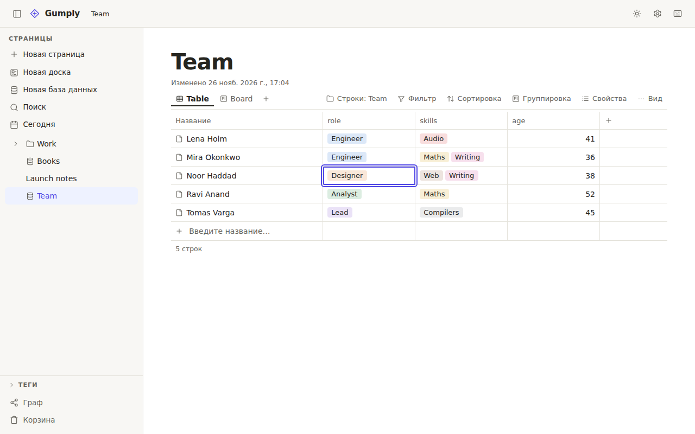
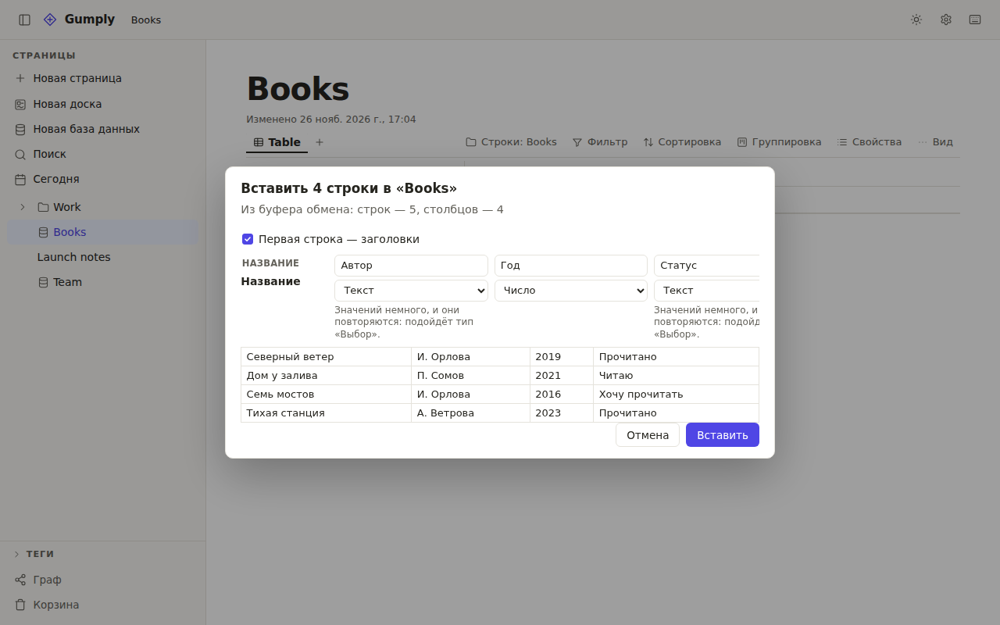
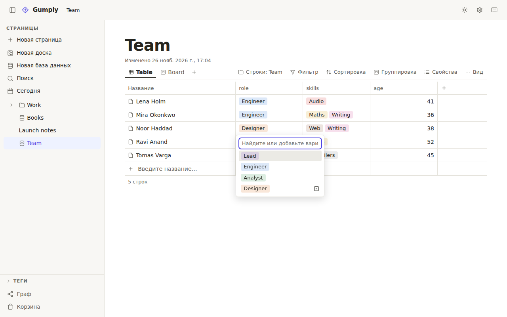
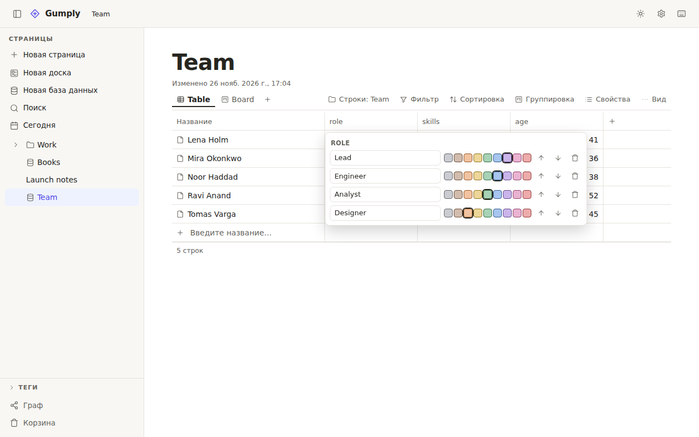
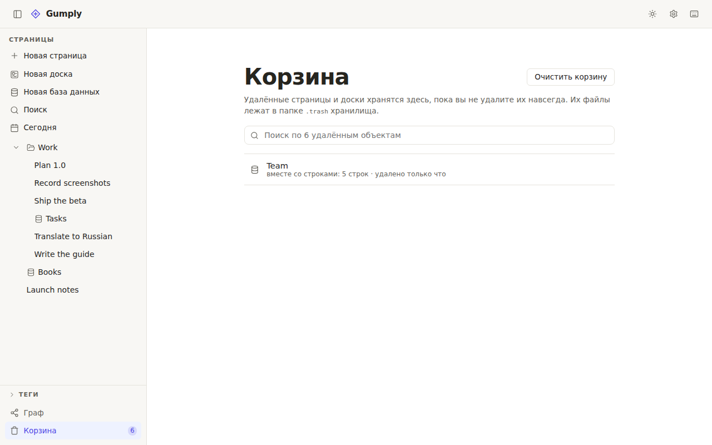

# Базы данных: свои таблицы

База данных — это таблица, которую вы заполняете сами, как электронную таблицу или базу данных в Notion: список людей, книг, поездок или задач. Каждая строка — обычная заметка, поэтому у неё есть ссылки, обратные ссылки, поиск, граф и своя история, а Obsidian видит ту же таблицу.

Если нужно показать страницы, которые у вас уже есть (например, все заметки с тегом), используйте [представление страниц](database-views.md).

**В этой главе:** [Создать](#создать-базу-данных) · [Заполнять как таблицу](#заполнять-как-электронную-таблицу) · [Свойства](#свойства-столбцы) · [Вставка из таблиц](#вставить-из-электронной-таблицы) · [Выбор и Множественный выбор](#выбор-и-множественный-выбор) · [Папка строк](#папка-строк-в-боковой-панели) · [Отмена](#отмена) · [Удалить и восстановить](#удалить-и-восстановить) · [Полезно знать](#полезно-знать)



## Создать базу данных

В боковой панели выберите **Новая база данных** (или найдите её через `Ctrl/Cmd+K`). Она называется «База данных без названия», и название сразу можно ввести: напишите, например, *Team* и нажмите Enter.

Gumply создаёт рядом две вещи:

```
Team.base     настройки таблицы: столбцы, представления и варианты
Team/         по заметке на строку, например Team/Ada Lovelace.md
```

Значения строки — это [свойства](properties-tags-templates.md) заметки, в начале её файла. Кнопка над таблицей говорит **Строки: Team** — так базу данных легко отличить от представления существующих страниц. Если нажать на неё, откроется короткая заметка о том, где хранятся строки.

## Заполнять как электронную таблицу

**Добавить строки:** последняя строка таблицы — **Введите название…**. Введите название и нажмите **Enter**, чтобы добавить строку и начать следующую, или **Tab**, чтобы добавить её и перейти к следующему столбцу.

**Перемещаться и править:** щёлкните ячейку или перейдите к ней стрелками — она станет *активной* (с рамкой).

| Клавиша | Что делает |
|---|---|
| Стрелки, **Tab**, **Shift+Tab** | Переход к соседней ячейке. Tab переходит на следующую строку. |
| Начать печатать | Заменяет значение тем, что вы вводите. |
| **Enter** | Открывает значение для правки; в редакторе Enter сохраняет и переходит вниз. |
| **Escape** | Отменяет правку; ячейка остаётся активной. |
| **Delete** или **Backspace** | Очищает значение. |
| **Пробел** | Ставит или снимает флажок. |
| **Shift+стрелки**, затем **Ctrl/Cmd+C** | Копирует блок ячеек, чтобы вставить его в электронную таблицу. |

Ввод по-русски, по-японски или любым другим способом ввода работает так же: первая буква не теряется.

Ячейка с названием — это заголовок заметки: если его изменить, заметка переименуется, а ссылки на неё обновятся.

## Свойства (столбцы)

**Добавить свойство:** нажмите **+** в конце заголовка, введите название и выберите тип: Текст, Число, Флажок, Дата, Дата и время, Список, **Выбор** или **Множественный выбор**. Если такое название уже используется в хранилище с другим типом, Gumply скажет об этом и оставит тот тип, чтобы они не расходились.

**Изменить свойство:** щёлкните заголовок столбца.

- **Переименовать** переименовывает свойство только в строках этой базы данных. Другие заметки с тем же названием свойства не меняются.
- **Тип** меняет тип, в том числе на **Выбор** или **Множественный выбор**: значения, которые уже есть в строках, становятся вариантами.
- **Удалить из всех строк** убирает значение из каждой строки этой базы данных. Сначала Gumply спросит, а старое значение останется в [истории](version-history.md) каждой строки.
- **Сортировать по возрастанию**, **Сортировать по убыванию** и **Скрыть в этом представлении** работают как в любом представлении.

## Вставить из электронной таблицы

Скопируйте ячейки в Excel, Google Таблицах, Numbers или таблице Notion и вставьте с помощью `Ctrl/Cmd+V`:

- **Одно значение** попадает в активную ячейку, как если бы вы его ввели.
- **Блок в ячейку** заполняет таблицу вниз и вправо от неё, как в электронной таблице. Строки сверх последней становятся новыми строками, а их названия берутся из первого столбца. Ячейки, которые нельзя вставить, пропускаются, и под таблицей указано, сколько их: ячейка поверх названия существующей строки (вставка не переименовывает), значение не того типа или столбец за последним.
- **Блок в строку «Введите название…»** или в пустую базу данных сначала открывает **предпросмотр**.



В предпросмотре:

- **Первая строка — заголовки** отмечено, если первая строка похожа на названия.
- У каждого столбца есть тип, угаданный по значениям. Любой можно поменять. Столбец, который уже есть в базе данных, сохраняет свой тип.
- У столбца, где значений немного и они повторяются, появляется подсказка *подойдёт тип «Выбор»*. Сам Gumply его не выбирает: выберите **Выбор**, чтобы значения стали вариантами. Вставка создаёт не больше 200 вариантов на столбец.
- Если строк больше 1000, Gumply переспросит перед вставкой.

Запятые при вставке не разделяют значения (в «Smith, John» запятая — часть имени). Для файла `.csv` есть **Импорт CSV…** в панели **⋯** базы данных: он открывает тот же предпросмотр.

Пока идёт большая вставка, над таблицей написано **Вставляется N строк… Остальные изменения подождут, пока вставка не закончится.** Другие ваши сохранения ждут её окончания, а потом проходят.

## Выбор и Множественный выбор

У свойства с типом «Выбор» есть список вариантов, у каждого свой цвет, а значение показывается цветной меткой. «Множественный выбор» может хранить несколько вариантов. Варианты принадлежат этой базе данных: в другой базе может быть свой «Статус» с другими вариантами.



- **Выбрать значение:** нажмите Enter на ячейке или начните печатать. Появится список вариантов; печатайте, чтобы найти нужный, затем стрелки и Enter. Если ничего не подходит, Enter добавит введённое как новый вариант. «Выбор» закрывается после выбора, «Множественный выбор» остаётся открытым для следующего.
- **Значение, введённое в другом месте** (например, в Obsidian), которого нет среди вариантов, показано простой меткой с пунктирной рамкой. **Добавить как вариант** делает его вариантом.
- **Изменить варианты…** в меню заголовка столбца показывает варианты. Там можно:
  - переименовать вариант — каждая строка с ним тоже обновится;
  - выбрать другой цвет;
  - переместить вариант выше или ниже;
  - удалить его. Gumply спросит: **Удалить и убрать из строк** или **Удалить, значения оставить**; оставленные значения останутся простыми метками.
- **Доска, сгруппированная по «Выбору»,** показывает столбцы в порядке вариантов, каждый своим цветом, даже пустые.



## Папка строк в боковой панели

В боковой панели видна сама база данных, а не папка с её строками, чтобы большая таблица не загромождала панель. Строки при этом есть везде: в поиске, `Ctrl/Cmd+K`, ссылках, обратных ссылках и графе.

Чтобы видеть их и в боковой панели, выберите **Показывать строки в боковой панели** в меню **⋯** базы данных. **Скрыть строки из боковой панели** возвращает как было.

## Отмена

Пока таблица открыта, **Ctrl/Cmd+Z** отменяет последнее изменение в ней, а **Ctrl/Cmd+Shift+Z** повторяет его: ячейку, вставку, новую строку, добавленное, переименованное или удалённое свойство, переименованный вариант. Вставка 40 строк или переименование в 12 строках — это один шаг.

**Отмену можно не получить.** Если строка изменилась после вашего изменения (в другой программе или при синхронизации), отмена записала бы поверх более нового текста, поэтому Gumply этого не делает и называет строки: *Нельзя отменить: эти строки изменились с тех пор: …*. Ничего не записывается. В [истории](version-history.md) строки остаются все версии.

Отмена действует, пока таблица открыта; после перезагрузки или закрытия всё начинается заново. В истории строки такие изменения подписаны **Изменение базы данных**.

## Удалить и восстановить

**Удалить базу данных** в её меню **⋯** спрашивает, **переместить ли в Корзину и её N строк** (по умолчанию да). Если в папке строк есть другие файлы (изображения, PDF), Gumply их назовёт.

- **Со строками:** база данных и её папка попадают в Корзину одним элементом — *Team, вместе со строками: 6 строк*. **Восстановить** возвращает их вместе.
- **Без строк:** удаляется только база данных. Строки остаются обычной папкой, которую теперь видно в боковой панели.



Отмена вставки перемещает созданные ею строки в Корзину одним элементом — *5 строк из «Team»*, — и их можно вернуть кнопкой **Восстановить**.

## Полезно знать

- **В Obsidian** база данных — обычная таблица Bases, а её папка — обычная папка заметок. Значения «Выбора» — простой текст, «Множественного выбора» — список, поэтому фильтры и доски Obsidian с ними работают; цвета и список вариантов есть только в Gumply.
- **Переименование или перемещение** базы данных в Gumply переносит и её папку, и наоборот.
- **Если другая программа** (Obsidian, файловый менеджер, синхронизация) переименует или переместит папку, база данных перестанет ею владеть: в таблице не будет строк, а папка появится в боковой панели. Ничего не теряется: верните папке прежнее название или дайте базе данных новое название папки.
- **Вставка блока** пропускает столбцы за последним; чтобы добавить столбцы, вставляйте в строку «Введите название…» и используйте предпросмотр.
- **Очень большая вставка** задерживает другие сохранения, пока идёт: около 30 секунд на 3000 строк.
- **Варианты** переставляются кнопками «выше» и «ниже» в **Изменить варианты…**, а не перетаскиванием.
- **Строки, убранные отменой**, если затем переименовать базу данных, восстанавливаются в папку со старым названием. Ничего не теряется.
