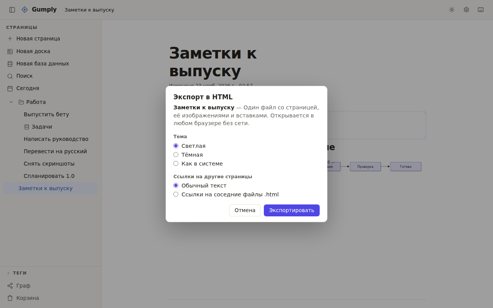

# Экспорт в HTML и PDF

Экспортируйте страницу, чтобы поделиться ею с тем, кто не пользуется Gumply.

Откройте меню страницы **⋯** в боковой панели или наберите в поиске (`Ctrl/Cmd+K`) «экспорт».

## HTML

**Экспорт в HTML…** записывает один файл `.html`, в котором есть всё: текст, изображения, превью страниц, снимки баз данных, формулы и диаграммы. Он открывается в любом браузере, без сети.

- **Тема:** светлая, тёмная или как в системе.
- **Ссылки на другие страницы:** обычный текст или ссылки на соседние файлы `.html` с такими же именами (удобно, если вы экспортируете несколько страниц в одну папку).

## PDF

**Экспорт в PDF…** раскладывает страницу для печати — в светлой теме, с обложкой, названием, изображениями, формулами и диаграммами.

- **Размер бумаги:** A4 или Letter.
- **Поля:** обычные или узкие.

Настольное приложение спросит, куда сохранить PDF (это есть и в его меню **Файл**). В браузере откроется окно печати: выберите там **Сохранить как PDF**.

## Доски

Доска экспортируется как изображение: её меню **⋯** → **PNG** или **SVG**. См. [Доски](boards.md).
