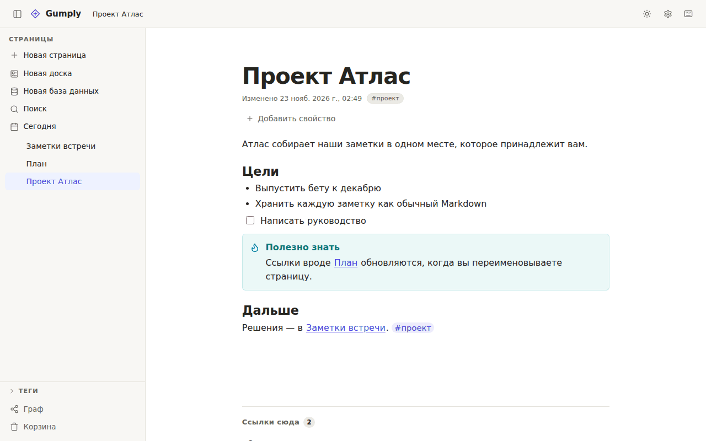

# Начало работы

Gumply — приложение для Linux, Windows и macOS. Его можно запустить и в браузере, из исходного кода.



## Установка

Скачайте установщик для своей системы на [странице выпусков](https://github.com/arslanarm/gumply/releases).

### Linux

- **Пакет `.deb`** (Ubuntu, Debian): установите его командой `sudo apt install ./Gumply-<версия>-amd64.deb`. После этого Gumply появится среди приложений.
- **AppImage** работает без установки. Сделайте файл исполняемым (`chmod +x Gumply-<версия>-x86_64.AppImage`) и откройте его. Нужен FUSE 3 (`fusermount`) — в Ubuntu 22.04 и новее он уже есть.

В Ubuntu 23.10 и новее пакет `.deb` сохраняет песочницу браузера, которая защищает приложение, а AppImage запускается без неё. Если это важно, выберите `.deb`.

### Windows

Запустите `Gumply-Setup-<версия>.exe`. Приложение пока не подписано, поэтому Windows один раз переспросит: выберите **Подробнее → Выполнить в любом случае**.

### macOS

Откройте `.dmg` (`-arm64` для Apple silicon, `-x64` для Intel) и перетащите Gumply в «Программы». Приложение пока не подписано, поэтому macOS заблокирует первый запуск. Откройте **Системные настройки → Конфиденциальность и безопасность**, найдите строку «Gumply заблокировано…» и выберите **Всё равно открыть**.

### В браузере, из исходного кода

Нужен Node 20 или новее.

```bash
npm install
npm run dev
```

Затем откройте <http://localhost:5173>. Хранилище — папка `vault` рядом с кодом. Чтобы взять другую папку, запустите так: `GUMPLY_VAULT=/путь/к/заметкам npm run dev`.

### Обновления

В Windows и в AppImage для Linux Gumply обновляется сам: скачивает новую версию в фоне и устанавливает её, когда вы в следующий раз закроете приложение. В macOS и с пакетом `.deb` он сообщает, что вышла новая версия. См. [Настройки](settings-and-shortcuts.md).

## Открыть или создать хранилище

**Хранилище** — это папка, в которой лежат ваши заметки. Каждая страница — файл `.md` в ней, а подстраницы лежат в папке с именем своей страницы.

При первом запуске Gumply предложит:

- **Открыть папку:** любую папку с файлами Markdown, в том числе хранилище Obsidian;
- **Создать хранилище:** пустую папку. Gumply добавит несколько демо-заметок, чтобы показать, что к чему; удалите их, когда захотите.

Позже пользуйтесь меню **Файл**: **Открыть хранилище…**, **Создать хранилище…**, **Недавние** и **Показать хранилище в файловом менеджере**.

## Хранилище Obsidian как есть

Gumply читает хранилище Obsidian, ничего не преобразуя:

- `[[ссылки]]`, `![[встраивания]]`, заголовки и псевдонимы находятся так же, как в Obsidian;
- свойства во frontmatter — с типами из `.obsidian/types.json`;
- выноски, теги, базы (`.base`), холсты (`.canvas`), настройки ежедневных заметок и шаблонов, обложки из плагина Banners;
- папки без собственной страницы показаны как папки.

**Чего Gumply никогда не делает с вашими файлами:**

- не меняет текст, который вы не трогали: при сохранении записывается только то, что вы изменили;
- не добавляет `title:`, `created:` или `updated:` в заметку, где их нет;
- ничего не пишет в `.obsidian/` — кроме типа свойства, который вы сами меняете.

Свои данные (историю версий, резервные копии при конфликтах) Gumply хранит в папке `.gumply` внутри хранилища. Удалённые страницы попадают в `.trash`. Полный список — в разделе [Если что-то не так](troubleshooting.md).

## Как здесь всё устроено

- **Боковая панель** показывает ваши страницы и доски. Перетаскивайте их, чтобы поменять порядок или вложить одну в другую. Наведите курсор на строку — появятся **+** (добавить страницу внутрь) и **⋯** (другие действия).
- **Поиск** (`Ctrl+K`, на Mac — `Cmd+K`) находит страницы по названию и тексту и выполняет команды, например «сегодня», «шаблон», «история» или «экспорт». Наберите сначала **>**, чтобы увидеть все команды: для этой страницы (переименовать, переместить, экспорт, история…), создание страниц и досок, **Вставить: …** и **Превратить в: …** в редакторе, инструменты и масштаб доски, тема, шрифт и ширина страницы, справка.
- **`?`** показывает все сочетания клавиш.
- **Шестерёнка** справа вверху открывает настройки: язык, тему, ИИ-приложения, историю версий и обновления.

## Дальше

- [Страницы и блоки](pages-and-blocks.md)
- [Ссылки и граф](links-and-graph.md)
