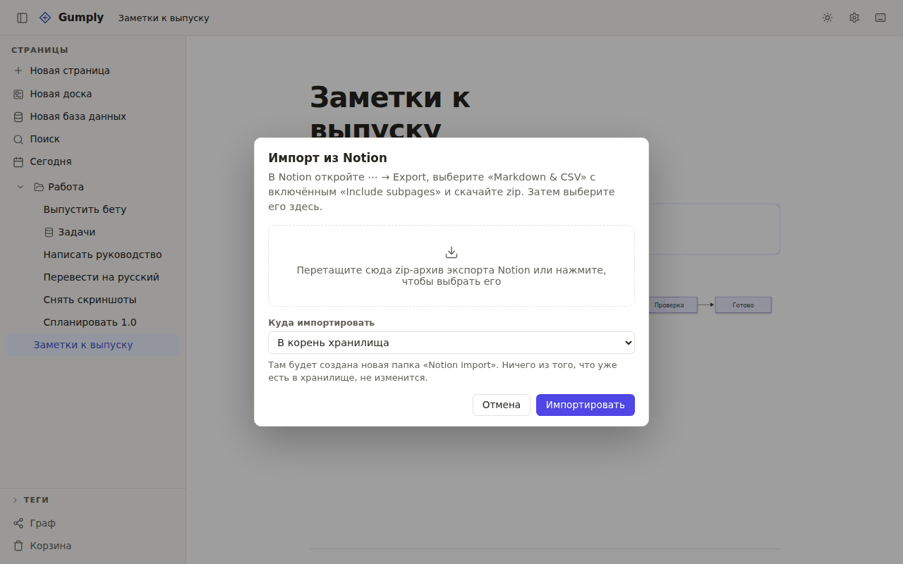

# Импорт из Notion

Перенесите в хранилище рабочее пространство или страницу Notion — вместе с подстраницами и базами данных.

## Экспорт из Notion

1. В Notion откройте страницу или рабочее пространство, затем **⋯ → Export**.
2. Выберите **Markdown & CSV** и включите **Include subpages**.
3. Скачайте zip-архив.

## Импорт

Выберите **Импорт из Notion…**: в поиске (`Ctrl/Cmd+K`), в меню **Файл** настольного приложения или в меню папки **⋯** (чтобы импортировать в эту папку). Перетащите архив или выберите его и нажмите **Импортировать**.

Всё попадает в новую папку `Notion import` (в следующий раз — `Notion import 2`). **Ничего из того, что уже есть в хранилище, не меняется.**

## Что переносится

- **Страницы и подстраницы** — как страницы Gumply, вложенные друг в друга.
- **Ссылки между страницами** и **@-упоминания** — как `[[ссылки]]`.
- **Изображения и файлы** — копируются в `attachments/Notion import/`.
- **Выноски** — как выноски, **блоки кода** — со своим языком.
- **Базы данных** превращаются в папку со страницей на каждую строку. Свойства строк становятся свойствами с типами: числа, даты, флажки, списки, а связи (relations) — `[[ссылками]]`. Для каждой базы создаётся и [база данных](database-views.md) Gumply: таблица в порядке столбцов Notion, а если в Notion база была доской — ещё и доска.

Типы свойств добавляются только для имён, которых в вашем хранилище ещё нет: ваши собственные типы всегда главнее.

## Что не переносится

Экспорт Notion не содержит настроек представлений, поэтому фильтры, сортировка, календари и галереи, цвета и комментарии не переносятся. Формулы, rollup-поля и люди приходят текстом, а файловые свойства — именами файлов.

## Отчёт

Когда импорт закончится, Gumply покажет, что он перенёс, что пропустил и почему. Этот же отчёт сохраняется как `Import report.md` в новой папке — на языке приложения.
