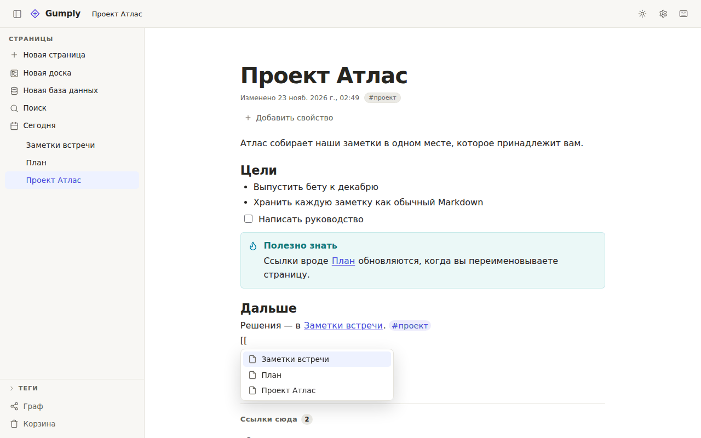

# Ссылки и граф

Связывайте страницы `[[двойными скобками]]`, как в Obsidian. Gumply не ломает ссылки, когда вы переименовываете или перемещаете страницы, и показывает, как страницы связаны.

## Ссылка на страницу

Наберите `[[` и начните вводить название. Выберите страницу в списке или **Создайте** новую.

- **Другой текст ссылки:** `[[План|наш план]]` показывает «наш план» и открывает страницу «План».
- **Ссылка на заголовок:** наберите `[[План#`, чтобы выбрать один из её заголовков. `[[#` показывает заголовки текущей страницы.
- **Встраивание:** `![[` встраивает файл или изображение (из любого места хранилища), доску (`![[Схема.canvas]]`) или базу данных.
- **Открыть ссылку:** нажмите на неё.

Если у нескольких страниц одно название, ссылка ведёт сначала на страницу из той же папки, где стоит ссылка, затем — на ту, у которой путь короче, как в Obsidian. Когда вы выбираете такую страницу в меню, Gumply записывает её путь (`[[Проекты/План|План]]`), чтобы ссылка всегда вела именно туда.

## Переименование без сломанных ссылок

- **Переименуйте страницу** — ссылки на неё на других страницах и досках обновятся. Меняются только ссылки, остальной текст этих файлов не трогается.
- **Переименуйте заголовок** — ссылки на него (`[[Страница#Старый]]`) тоже обновятся.
- **Переместите страницу** в другую папку — её ссылки продолжат работать, а ссылки на её изображения и файлы поправятся.
- **Переименовали в другой программе** (Obsidian, файловый менеджер) — боковая панель покажет новое название почти сразу, а ссылки, которые переписала та программа, работают как есть. Если страница открыта, она останется открытой под новым названием вместе с тем, что вы печатали, а её [история](version-history.md) перейдёт вместе с ней.

## Кто ссылается сюда

Внизу каждой страницы раздел **Ссылки сюда** показывает страницы и доски, которые на неё ссылаются, со строкой вокруг каждой ссылки.

Под ним **Несвязанные упоминания** показывают страницы, где название этой страницы (или один из её псевдонимов `aliases`) упомянуто без ссылки. Выберите **Связать** для одного упоминания или **Связать все**.

## Граф

Выберите **Граф** в боковой панели: каждая страница — точка, каждая ссылка — линия.

- **Чем больше точка**, тем больше у страницы связей. Доски — квадраты. Пунктирный кружок — страница, на которую есть ссылка, но которой ещё нет: нажмите, чтобы создать её.
- **Фильтруйте** по названию в строке поиска или по тегу — значками под ней.
- **Настройки графа** (кнопка с воронкой) скрывают или показывают теги, вложения, ещё не созданные страницы и страницы без связей. **Группы** окрашивают страницы по запросу, например `tag:#работа` или `path:Проекты`. Настройки сохраняются для каждого хранилища.
- **Навигация:** колесо — масштаб, перетаскивание — сдвиг, **Вместить** — показать всё. Нажмите на точку, чтобы открыть страницу.

### Локальный граф

На любой странице кнопка **Локальный граф** в шапке показывает только эту страницу и её соседей на одну-две ссылки — в колонке рядом со страницей.

## Структура

**Структура** (`Ctrl/Cmd+Shift+O`) показывает заголовки страницы рядом с ней — или фреймы доски. Нажмите на пункт, чтобы перейти к нему. Структура делит боковую колонку с локальным графом.

## Полезно знать

- Ссылки в **свойствах** тоже считаются: свойство со значением `"[[План]]"` — это ссылка, и в графе, и в разделе «Ссылки сюда».
- Ссылка на страницу, которой ещё нет, всё равно ссылка. В графе она пунктирная, пока вы не создадите страницу.
- `\[[не ссылка]]` (с обратной косой чертой) остаётся простым текстом, как в Obsidian.
