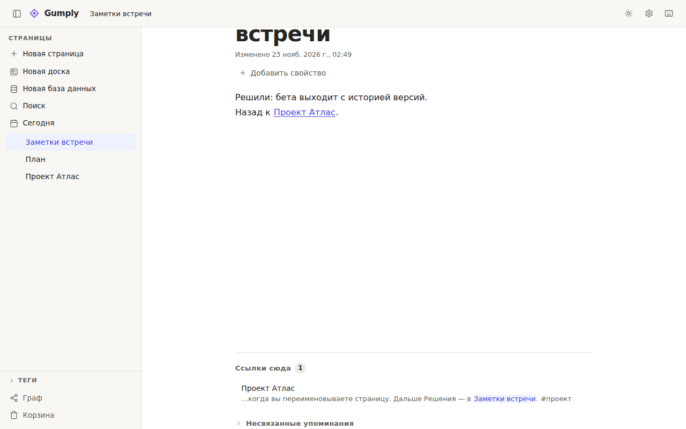
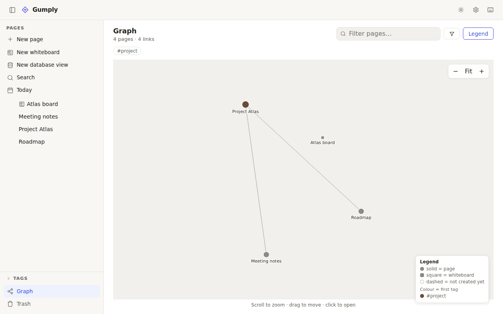

# Ссылки и граф

Связывайте страницы `[[двойными скобками]]`, как в Obsidian. Gumply не ломает ссылки, когда вы переименовываете или перемещаете страницы, и показывает, как страницы связаны.

## Ссылка на страницу

Наберите `[[` и начните вводить название. Выберите страницу в списке или **Создайте** новую.

- **Другой текст ссылки:** `[[План|наш план]]` показывает «наш план» и открывает страницу «План».
- **Ссылка на заголовок:** наберите `[[План#`, чтобы выбрать один из её заголовков. `[[#` показывает заголовки текущей страницы.
- **Встраивание:** `![[` встраивает файл или изображение (из любого места хранилища), доску (`![[Схема.canvas]]`) или базу данных.
- **Открыть ссылку:** нажмите на неё.
- **Ссылки Markdown тоже работают:** `[наш план](План.md)` — второй способ записать ссылку в Obsidian — открывает страницу и везде ниже считается ссылкой на неё.

Если у нескольких страниц одно название, ссылка ведёт сначала на страницу из той же папки, где стоит ссылка, затем — на ту, у которой путь короче, как в Obsidian. Когда вы выбираете такую страницу в меню, Gumply записывает её путь (`[[Проекты/План|План]]`), чтобы ссылка всегда вела именно туда.

## Переименование без сломанных ссылок

- **Переименуйте страницу** — ссылки на неё на других страницах и досках обновятся, в том числе ссылки Markdown (`[текст](Старое название.md)`), каждая в том виде, в каком была записана. Меняются только ссылки, остальной текст этих файлов не трогается.
- **Переименуйте заголовок** — ссылки на него (`[[Страница#Старый]]`) тоже обновятся.
- **Переместите страницу** в другую папку — её ссылки продолжат работать, ссылки на её изображения и файлы поправятся, а ссылки Markdown на неё получат её новый путь.
- **Переименовали в другой программе** (Obsidian, файловый менеджер или программа синхронизации, которая присылает удаление старого файла и новый файл с разницей в несколько секунд) — боковая панель покажет новое название почти сразу, а ссылки, которые переписала та программа, работают как есть. Если страница открыта, она останется открытой под новым названием вместе с тем, что вы печатали, а её [история](version-history.md) перейдёт вместе с ней.

## Кто ссылается сюда

Внизу каждой страницы раздел **Ссылки сюда** показывает страницы и доски, которые на неё ссылаются — и ссылками `[[…]]`, и ссылками Markdown, — со строкой вокруг каждой ссылки.

Под ним **Несвязанные упоминания** показывают страницы, где название этой страницы (или один из её псевдонимов `aliases`) упомянуто без ссылки. Выберите **Связать** для одного упоминания или **Связать все**.

## Граф

Выберите **Граф** в боковой панели: каждая страница — точка, каждая ссылка — линия.

- **Чем больше точка**, тем больше у страницы связей. Доски — квадраты. Пунктирный кружок — страница, на которую есть ссылка, но которой ещё нет: нажмите, чтобы создать её.
- **Фильтруйте** по названию в строке поиска или по тегу — значками под ней.
- **Настройки графа** (кнопка с воронкой) скрывают или показывают теги, вложения, ещё не созданные страницы и страницы без связей. **Группы** окрашивают страницы по запросу, например `tag:#работа` или `path:Проекты`. Настройки сохраняются для каждого хранилища.
- **Навигация:** колесо — масштаб, перетаскивание — сдвиг, **Вместить** — показать всё. Нажмите на точку, чтобы открыть страницу.

### Локальный граф

На любой странице кнопка **Локальный граф** в шапке показывает только эту страницу и её соседей на одну-две ссылки — в колонке рядом со страницей.

### Большие хранилища

- **Сразу после открытия** хранилища с тысячами заметок боковая панель и страницы доступны сразу, а Gumply ещё читает ссылки между ними. В это время граф и раздел **Ссылки сюда** показывают **Индексация ссылок…**, а потом заполняются. Когда они заполнились, ничего не пропущено.
- **Граф больше чем из 5000 заметок** сначала показывает начальную раскладку приглушённой, с надписью **Граф раскладывается… 40%**, и появляется, когда раскладка устоится. На медленном компьютере это может занять время, но остальным приложением можно пользоваться. **Когда вы откроете тот же граф снова**, он появится разложенным сразу: Gumply запоминает раскладку на этом компьютере (не в хранилище), пока не изменятся страницы или ссылки.
- **Пока вы приближаете или двигаете** большой граф, его линии ненадолго скрываются и возвращаются, когда вы остановитесь, — так движение остаётся плавным.

## Структура

**Структура** (`Ctrl/Cmd+Shift+O`) показывает заголовки страницы рядом с ней — или фреймы доски. Нажмите на пункт, чтобы перейти к нему. Структура делит боковую колонку с локальным графом.

## Полезно знать

- Ссылки в **свойствах** тоже считаются: свойство со значением `"[[План]]"` — это ссылка, и в графе, и в разделе «Ссылки сюда».
- Ссылка на страницу, которой ещё нет, всё равно ссылка. В графе она пунктирная, пока вы не создадите страницу.
- `\[[не ссылка]]` и `\[не ссылка](План.md)` (с обратной косой чертой) остаются простым текстом, как в Obsidian.
- Ссылка Markdown на несуществующую страницу (`[x](Нет такой.md)`) не появляется в графе: это путь, а не название.
