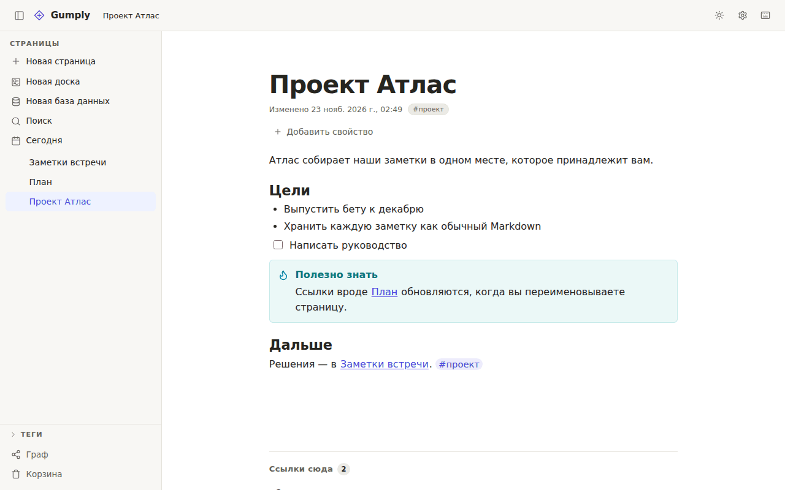
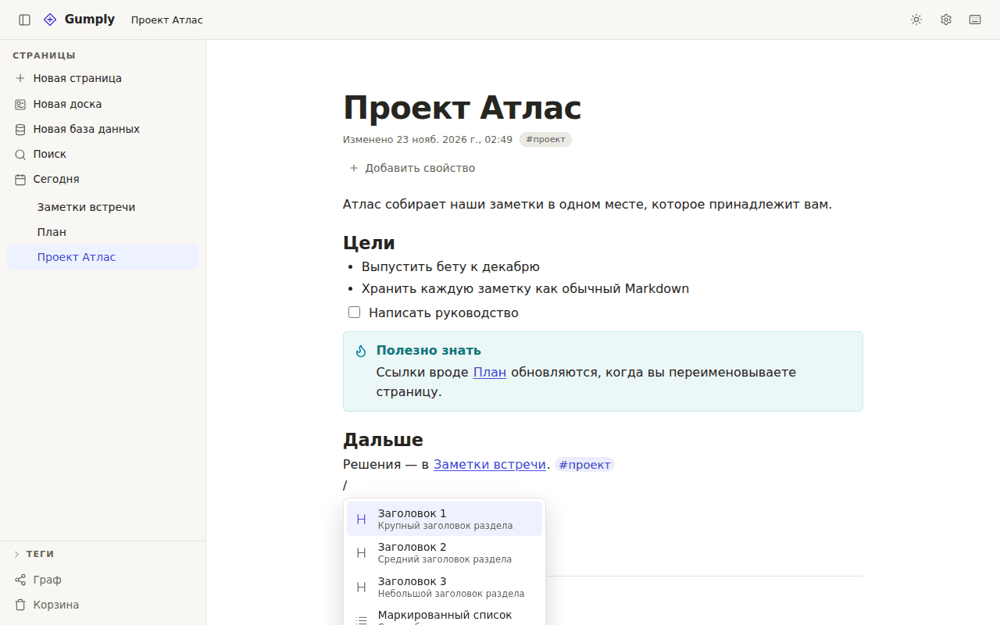

# Страницы и блоки

Страница — это файл Markdown. То, что вы видите как блоки (абзацы, заголовки, списки, выноски), — обычные строки Markdown в этом файле, поэтому в любом другом редакторе страница читается так же.



## Создать страницу

- В боковой панели выберите **Новая страница**.
- Чтобы положить страницу внутрь другой, наведите курсор на родительскую страницу в боковой панели и нажмите **+** — или перетащите страницу на неё.
- В поиске (`Ctrl/Cmd+K`) наберите название, которого ещё нет, и выберите **Создать «…»**.
- Наберите `[[`, затем новое название и выберите **Создать**. Получится ссылка на новую страницу.

Имя файла следует за названием страницы: «План на квартал» — это `План на квартал.md`. Если переименовать страницу, переименуется и файл, а ссылки на неё обновятся (см. [Ссылки](links-and-graph.md)).

Нажмите `Enter` в названии, чтобы перейти к тексту.

## Пишите блоками

Просто печатайте — текст сам становится блоками:

| Наберите в начале строки | Получится |
|---|---|
| `#`, `##`, `###` и пробел | заголовок |
| `-` и пробел | маркированный список |
| `1.` и пробел | нумерованный список |
| `- [ ]` и пробел | задача |
| `>` и пробел | раскрывающийся блок (сворачивается) |
| `"` и пробел | цитата |
| ```` ``` ```` | блок кода |
| `:` и несколько букв | эмодзи, например `:rocket` |

### Меню `/`

Наберите `/`, чтобы вставить любой блок: заголовки, списки, задачи, цитаты, выноски (заметка, совет, предупреждение), раскрывающиеся блоки, код, диаграммы Mermaid, формулы, таблицы, эмодзи, изображения и файлы, доску, шаблон страницы или доски, превью страницы, базу данных и разделители. Продолжайте печатать, чтобы сузить список, выбирайте стрелками и нажмите `Enter`.



### Перемещать и менять блоки

Наведите курсор на блок — слева появится ручка (`⋮⋮`):

- **перетащите** ручку, чтобы переместить блок;
- **нажмите** на неё, чтобы открыть действия с блоком: **Превратить в** (другой вид блока или колонки), **Дублировать**, **Переместить вверх / вниз**, **Копировать ссылку на блок**, **Удалить** и другие.

С клавиатуры: `Ctrl/Cmd+Shift+↑/↓` двигает блок вверх или вниз, `Ctrl/Cmd+D` дублирует его.

### Оформление текста

Выделите текст — появится панель форматирования: жирный, курсив, зачёркнутый, код в строке, ссылка, выделение цветом, **цвет** текста и фона и **Превратить в**. Работают и привычные сочетания (`Ctrl/Cmd+B`, `Ctrl/Cmd+I`).

### Выноски и раскрывающиеся блоки

**Выноска** — цветная рамка с заголовком: для заметки, совета или предупреждения. **Раскрывающийся блок** — блок, содержимое которого сворачивается. В файле это выноски Obsidian (`> [!note]`), поэтому в Obsidian они выглядят так же. Открыт ли раскрывающийся блок по умолчанию, задаётся в его действиях; если вы раскрываете его при чтении, файл не меняется.

### Таблицы, изображения и файлы

- **Таблицы:** `/таблица` (или `/table`), затем печатайте. Наведите курсор на край таблицы, чтобы добавить или убрать строки и столбцы.
- **Изображения и файлы:** перетащите их на страницу, вставьте из буфера или выберите `/изображение` и `/файл`. Gumply сохраняет их в папке `attachments` хранилища и ставит на них ссылку со страницы.
- **Размер изображения:** щёлкните изображение и потяните ручку сбоку. Размер останавливается на четверти, половине, трёх четвертях или всей ширине страницы (с `Alt` — любой). Когда изображение выделено, то же делают `Shift+←` и `Shift+→`. Ширина сохраняется так, как её пишет Obsidian (`![[pic.png|300]]`), поэтому там изображение будет того же размера. Перемещается изображение, как любой блок, за `⋮⋮`.

## Оформление страницы

Наведите курсор на название, чтобы добавить **значок** (эмодзи), **обложку** (изображение из хранилища, цвет или градиент) или **фон** страницы. Они хранятся как свойства во frontmatter страницы.

## Удалить и восстановить

- Удалите страницу из её меню **⋯**. Она попадёт в **Корзину**, а на несколько секунд появится кнопка **Отменить**.
- Если у страницы есть подстраницы, Gumply сначала переспросит.
- **Корзина** внизу боковой панели показывает всё удалённое. **Восстановить** возвращает страницу на место; **Удалить навсегда** удаляет её вместе с [историей версий](version-history.md).

## Полезно знать

- Gumply сохраняет на ходу. `Ctrl/Cmd+S` сохраняет сразу.
- Если другая программа изменила страницу, пока вы печатали, Gumply не перезапишет её молча. Он покажет **Эта страница изменилась на диске.** и кнопки **Загрузить заново** (взять их вариант) и **Оставить мою** (сохранить ваш и оставить резервную копию их варианта). В любом случае обе версии попадут в [историю](version-history.md) страницы.
- Заметка без frontmatter так и останется без него. Gumply добавит frontmatter, только когда он действительно нужен — например, для значка или тегов.
