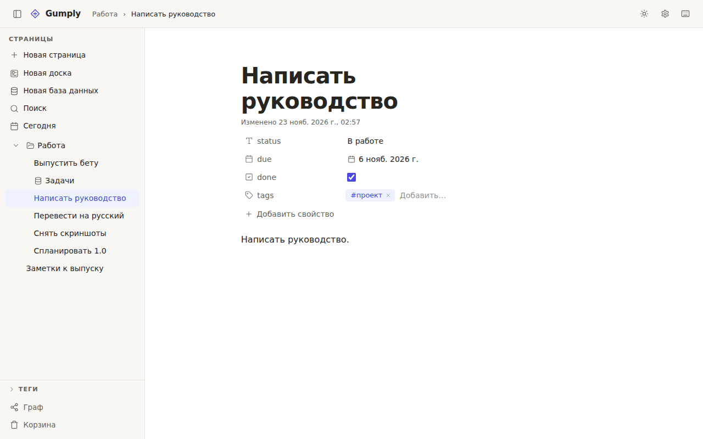

# Свойства, теги и шаблоны

## Свойства

Свойства — это сведения о странице: статус, срок, флажок, список людей. Они хранятся во frontmatter страницы — блоке YAML в начале файла, как в Obsidian.

- **Добавить свойство:** нажмите **Добавить свойство** под названием, введите имя, затем значение.
- **Сменить тип**, **переименовать** или **удалить:** нажмите на имя свойства.
- **Типы:** Текст, Список, Число, Флажок, Дата, Дата и время, Теги и Псевдонимы.

Тип действует на все страницы с этим именем свойства. Gumply читает и записывает типы там же, где их хранит Obsidian, — в `.obsidian/types.json`. В хранилище без папки `.obsidian` они лежат в `.gumply/types.json`.

Когда вы правите свойство, в файле меняется только его строка. Ключи, которыми вы не пользуетесь, комментарии и порядок строк остаются как были.

Свойства питают [базы данных](database-views.md), а свойство со значением-`[[ссылкой]]` считается [ссылкой](links-and-graph.md).

## Теги

Поставить тег можно двумя способами:

- в тексте: `#проект` или вложенный `#проект/атлас`;
- в свойстве **tags**.

Раздел **Теги** внизу боковой панели показывает все теги и число страниц с каждым. Нажмите на тег, чтобы найти его страницы; вложенный тег находит и теги под ним.

**Переименовать тег:** наведите на него курсор в разделе «Теги» и нажмите **✎** — или щёлкните правой кнопкой. Gumply переименует его везде: в тексте и в свойствах, вместе с вложенными. Меняются только теги.

Теги подчиняются правилам Obsidian. `#2024` сам по себе не тег (в теге нужна хотя бы одна буква), а теги внутри кода, ссылок и адресов не считаются. Если на странице записано `tags: a, b` строкой, Gumply покажет теги с предупреждением, что Obsidian их не прочтёт, а **Сделать списком** исправит только эту строку.

## Шаблоны страниц

Шаблон — обычная страница в папке шаблонов: по умолчанию `Templates` или папка из настроек плагина «Шаблоны» в Obsidian.

- **Новая страница из шаблона:** в поиске (`Ctrl/Cmd+K`) — **Новая страница из шаблона…**, или меню страницы **⋯** → **Новая страница из шаблона…**, чтобы положить её внутрь.
- **Вставить шаблон в страницу:** наберите `/шаблон` (или `/template`).

В шаблоне `{{title}}` превращается в название новой страницы, а `{{date}}` и `{{time}}` — в текущие дату и время, в форматах из настроек шаблонов Obsidian.

Шаблоны досок (канбан, карта мыслей и другие) описаны в разделе [Доски](boards.md).
