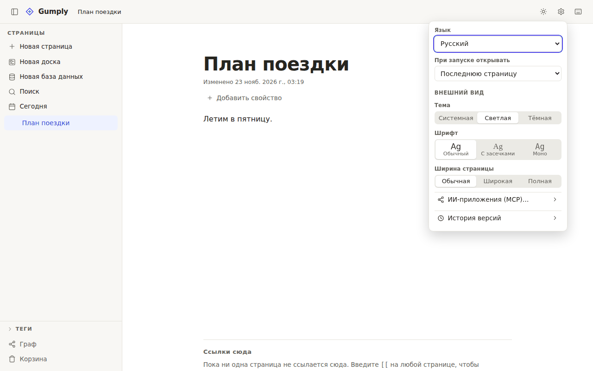
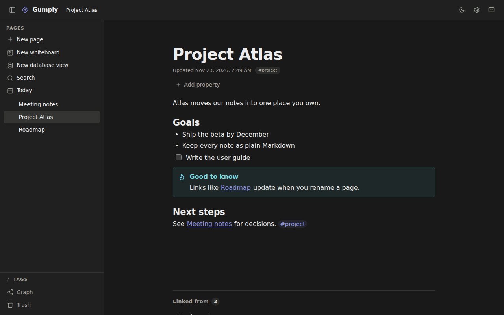
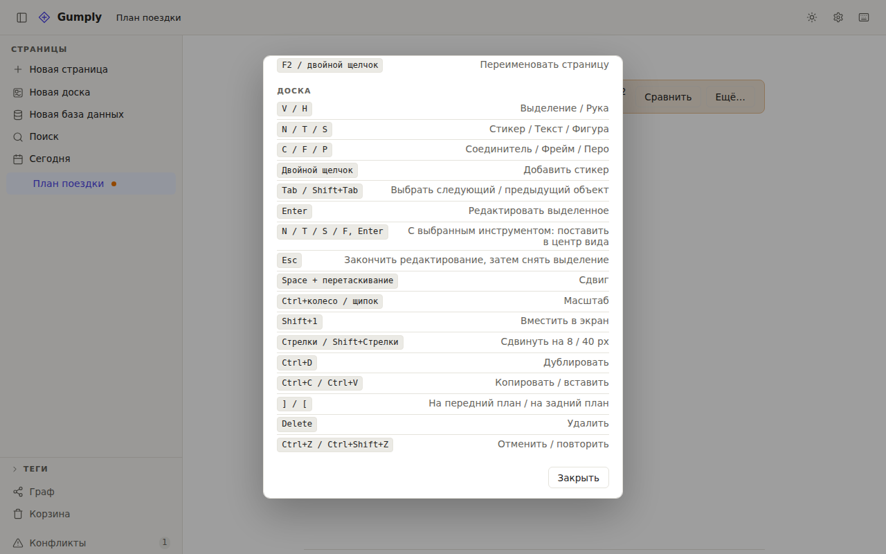

# Настройки и сочетания клавиш

## Настройки

Откройте их шестерёнкой справа вверху.



- **Язык:** английский или русский — или как в системе. Меню настольного приложения следуют ему.
- **При запуске открывать:** **Последнюю страницу**, **Выбранную страницу** (её выбирают кнопкой **Выбрать…**) или **Заметку на сегодня**. Выбранная страница остаётся выбранной, если её переименовать или переместить; если её удалили, в настройках будет написано **Выбранная страница удалена**.
- **Внешний вид:**
  - **Тема:** Системная, Светлая или Тёмная. Переключает её и кнопка с солнцем или луной рядом с шестерёнкой.
  - **Шрифт** страниц: **Обычный**, **С засечками** или **Моно**.
  - **Ширина страницы:** **Обычная**, **Широкая** или **Полная** (во всё окно).
- **ИИ-приложения (MCP)…** — разрешить ИИ-приложениям работать с хранилищем. См. [ИИ-приложения](ai-apps.md).
- **История версий** — сколько места она занимает, очистка старых версий и строки для Syncthing. См. [История версий](version-history.md).
- **Обновления…** (только в настольном приложении) — что делать, когда выходит новая версия:
  - **Скачивать и устанавливать обновления автоматически** (Windows и AppImage для Linux): Gumply скачивает обновление в фоне и устанавливает его, когда вы в следующий раз закроете приложение. Без вас ничего не перезапускается; **Перезапустить** устанавливает сразу.
  - **Только сообщать о новой версии** (в macOS и с пакетом `.deb` — всегда так).
  - **Не проверять обновления.**
  - **Проверить сейчас.** При проверке Gumply спрашивает у GitHub последний выпуск; GitHub видит ваш IP-адрес, больше ничего не передаётся.



Настройки хранятся на каждом устройстве свои: в настольном приложении — в папке пользовательских настроек, в браузере — в браузере. В хранилище они не попадают никогда.

## Сочетания клавиш

Нажмите `?` где угодно (кроме поля ввода), чтобы увидеть их все. На Mac вместо `Ctrl` — `Cmd`.



### Навигация

| Клавиши | Что делают |
|---|---|
| `Ctrl+K` | Поиск по страницам и команды (`>` — все команды) |
| `Ctrl+\` | Показать или скрыть боковую панель |
| `Ctrl+Shift+D` | Открыть заметку на сегодня |
| `Ctrl+Shift+O` (или `Ctrl+Alt+O`) | Показать или скрыть структуру |
| `?` | Все сочетания клавиш |

### Текст

| Клавиши | Что делают |
|---|---|
| `/` | Вставить блок |
| `[[` | Ссылка на страницу |
| `#` `##` `###` и пробел | Заголовок |
| `-` / `1.` / `- [ ]` и пробел | Маркированный список / нумерованный список / задача |
| `>` и пробел | Раскрывающийся блок |
| `"` и пробел | Цитата |
| ```` ``` ```` | Блок кода |
| `Ctrl+B` / `Ctrl+I` / `Ctrl+E` | Жирный / курсив / код в строке |
| `Ctrl+Shift+S` / `Ctrl+Shift+H` | Зачёркнутый / выделение цветом |
| `Ctrl+Z` | Отменить |
| `Ctrl+S` | Сохранить сейчас |
| `Ctrl+Shift+↑ / ↓` | Переместить блок вверх / вниз |
| `Ctrl+D` | Дублировать блок |
| `Ctrl+Alt+← / →` | Перенести блок в соседнюю колонку |

### Страницы

| Клавиши | Что делают |
|---|---|
| `Enter` в названии | Перейти к тексту страницы |
| `F2` или двойной щелчок в боковой панели | Переименовать страницу |
| `Shift+F10` или клавиша меню на строке боковой панели | Открыть меню строки |
| `↑` `↓` `←` `→`, `Home` / `End` в боковой панели | Перейти между страницами; раскрыть и свернуть подстраницы |
| Ввод букв в боковой панели | Перейти к странице, название которой с них начинается |

### Доски

| Клавиши | Что делают |
|---|---|
| `V` / `H` | Выделение / Рука |
| `N` / `T` / `S` | Стикер / Текст / Фигура |
| `C` / `F` / `P` | Соединитель / Фрейм / Перо |
| `Tab` / `Shift+Tab` | Выбрать следующий / предыдущий объект |
| `Enter` | Редактировать выделенное |
| клавиша инструмента, затем `Enter` | Поставить объект в центр вида |
| `Esc` | Закончить редактирование, затем снять выделение |
| Двойной щелчок | Добавить стикер |
| `Пробел` + перетаскивание | Сдвиг |
| `Ctrl` + колесо или щипок | Масштаб |
| `Shift+1` | Вместить в экран |
| Стрелки / `Shift`+стрелки | Сдвинуть на 8 / 40 px |
| `Ctrl+D` | Дублировать |
| `Ctrl+C` / `Ctrl+V` | Копировать / вставить |
| `]` / `[` | На передний план / на задний план |
| `Delete` | Удалить |
| `Ctrl+Z` / `Ctrl+Shift+Z` | Отменить / повторить |
