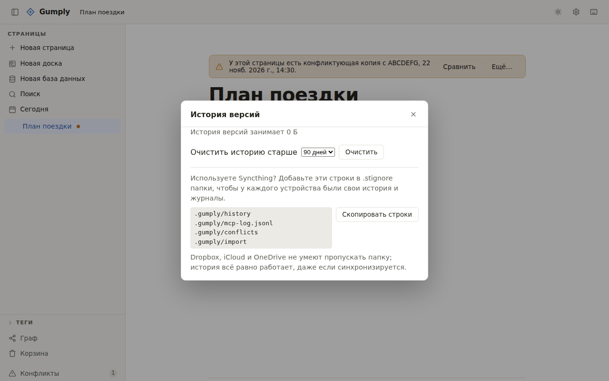
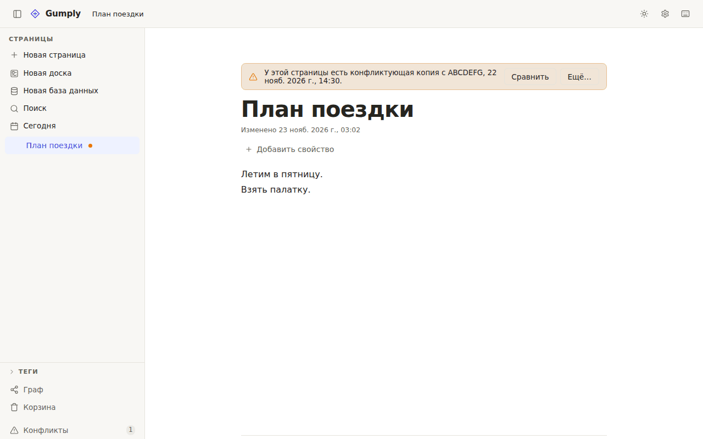
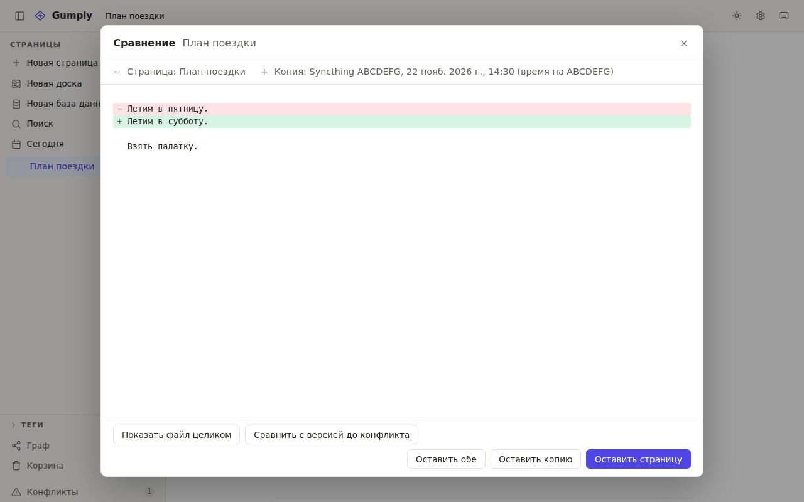
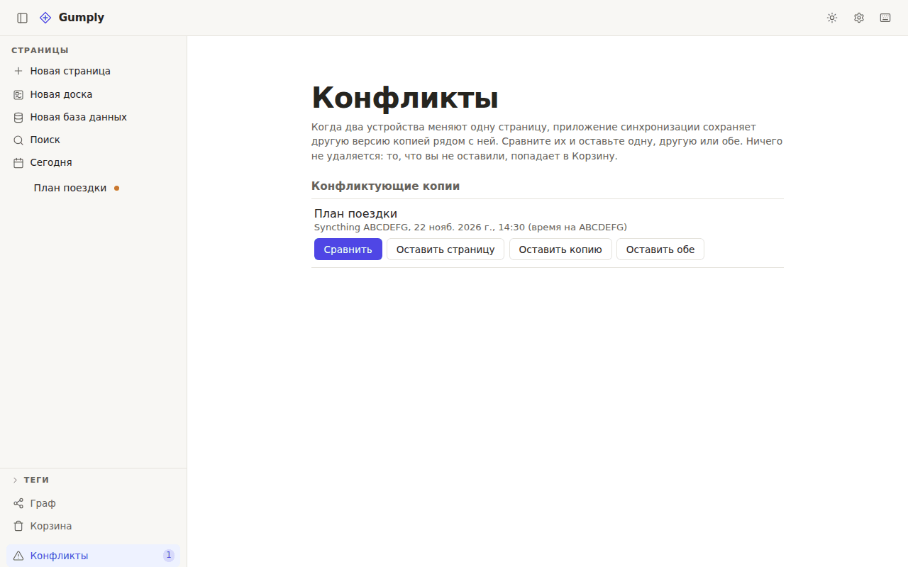

# Синхронизация с другими программами

У Gumply нет собственной синхронизации. Хранилище — это папка, поэтому синхронизировать её между устройствами можно тем, чем вы уже пользуетесь: Syncthing, Dropbox, iCloud Drive, OneDrive, Nextcloud, Obsidian Sync или git.

## Настройка

1. Положите папку хранилища в синхронизируемую папку (или откройте хранилище, которое уже там).
2. **Syncthing:** добавьте несколько строк в `.stignore` этой папки, чтобы у каждого устройства была своя история версий, а рабочие файлы Gumply не путешествовали. Строки даёт сам Gumply: шестерёнка → **История версий** → **Скопировать строки**. Сам Gumply `.stignore` никогда не пишет.

```
.gumply/history
.gumply/mcp-log.jsonl
.gumply/conflicts
.gumply/import
```

Dropbox, iCloud и OneDrive не умеют пропускать папку. Ничего страшного: история работает, даже если синхронизируется.



## Если два устройства изменили одну страницу

Если вы правите страницу на двух устройствах до того, как они синхронизировались, программа синхронизации сохраняет вторую сторону как **конфликтующую копию** рядом со страницей, например `План поездки.sync-conflict-20261122-143005-ABCDEFG.md`. Gumply узнаёт копии Syncthing, Dropbox, Nextcloud и Obsidian Sync и:

- **скрывает копию** из боковой панели, а страницу помечает оранжевой точкой;
- показывает на странице **баннер**: кто и когда сделал копию, с кнопкой **Сравнить**;
- перечисляет все конфликты в разделе **Конфликты** внизу боковой панели (только пока они есть) и в поиске: **Показать конфликты**.



### Сравните и оставьте одну или обе

**Сравнить** показывает страницу и копию рядом, с отмеченными различиями.



Затем выберите:

- **Оставить страницу** — копия уходит в Корзину.
- **Оставить копию** — текст копии заменяет страницу. Прежний текст страницы остаётся в её [истории версий](version-history.md).
- **Оставить обе** — копия становится отдельной страницей с именем `<название> (copy <дата>)`.

Любой выбор можно отменить из сообщения, которое появится после него. До вашего выбора ничего не записывается, а если какой-то из файлов изменится, пока вы сравниваете, Gumply попросит проверить снова.



### Возможные копии

iCloud, OneDrive и Google Drive называют копии как обычные страницы (`План поездки 2`, `План поездки-Laptop`, `План поездки (1)`), поэтому Gumply не может знать наверняка. Если у такой страницы почти тот же текст, что у страницы рядом, она попадает в раздел **Возможные копии** в «Конфликтах» — с кнопками **Сравнить** и **Не копия**.

## Полезно знать

- Копия, открытая из поиска или по ссылке, доступна **только для чтения**, чтобы не появилась третья версия.
- Копии не попадают в граф, «Ссылки сюда», теги и базы данных. Поиск их находит и помечает как **Конфликтующая копия**.
- Когда сразу меняется много файлов (синхронизация, `git checkout`), в боковой панели видно **Синхронизация изменений…**, пока Gumply не догонит. Ваши собственные сохранения идут первыми.
- Конфликтующие копии изображений и других файлов показываются в списке, но разбираться с ними нужно в файловом менеджере.
- Какие файлы Gumply можно синхронизировать или удалять и какие имена он считает конфликтующими копиями — в описании [формата файлов Gumply](../../file-format.md) (на английском).
