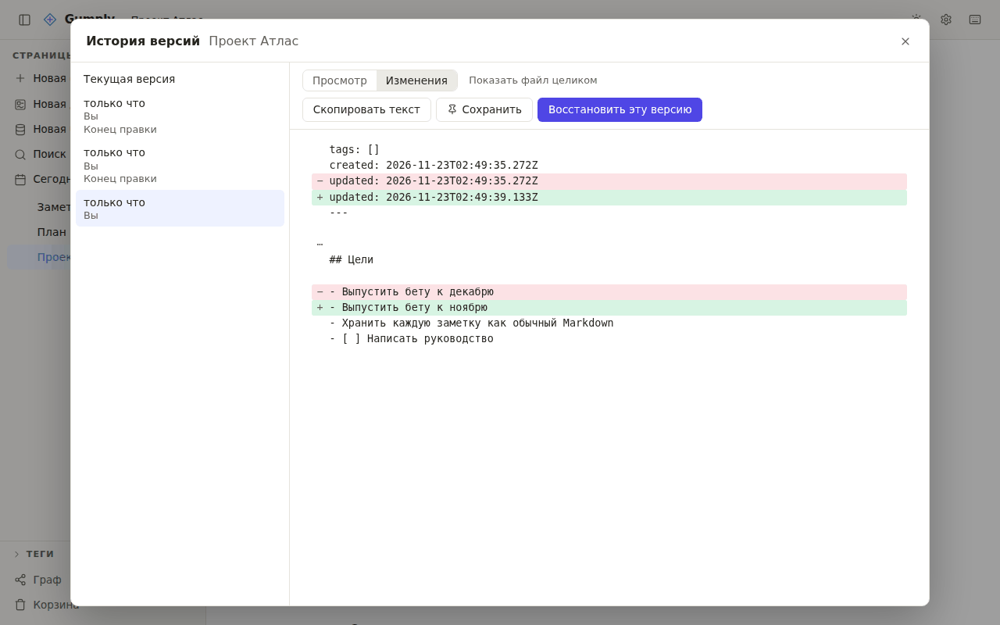

# История версий

Gumply хранит прежние версии каждой страницы и доски. Видно, кто и когда что изменил; версию можно сравнить с текущей и восстановить. Восстановление тоже можно отменить.

## Открыть историю

- В боковой панели: меню страницы **⋯** → **История…**
- Или в поиске (`Ctrl/Cmd+K`) → **Показать историю страницы** — для открытой страницы или доски.

**Слева** — версии, новые сверху. У каждой указано, когда и кем она сделана:

- **Вы** — сохранено вами в Gumply. **Конец правки** отмечает последнее состояние сеанса правки.
- **Изменено вне Gumply** — файл изменила другая программа (Obsidian, текстовый редактор, git, программа синхронизации).
- **ИИ-приложение (…)** — изменения внесло ИИ-приложение через [MCP-сервер Gumply](ai-apps.md).
- **Импорт из Notion**, **До восстановления**, а также **Переименовано из / Перемещено из**, если тогда у страницы было другое название или папка.

**Справа** — выбранная версия:

- **Просмотр** показывает её такой, какой страница была тогда. Для доски это сама доска — её можно двигать и масштабировать.
- **Изменения** показывают, чем версия отличается от текущей: добавленные строки зелёные со знаком **+**, удалённые — красные со знаком **−**. **Показать файл целиком** покажет и строки вокруг. Для доски «Изменения» отмечают карточки: добавленные (зелёная рамка), удалённые (бледные, красная пунктирная рамка) и изменённые (янтарная рамка) — и ниже список этих карточек.

## Восстановить версию

Выберите её и нажмите **Восстановить эту версию**. Страница получит текст этой версии в точности, как он был, а название и место останутся текущими. Если у версии было другое название, об этом скажет заметка над ней.

**Отменить восстановление:** версия перед ним стоит в начале списка как **До восстановления**. Восстановите её.

Если пока вы смотрели историю, страницу изменила другая программа, Gumply попросит заново проверить список, а не перезапишет изменения.

## Сохранить версию

**Сохранить** помечает версию, чтобы её никогда не удаляли. Сохранённые версии отмечены в списке значком булавки.

## Когда появляются версии

- **Пока вы печатаете** — не чаще раза в 5 минут, чтобы долгий сеанс не забивал список.
- **Когда вы остановились** — через 10 минут без правок, когда открываете другую страницу или закрываете приложение — последнее состояние сохраняется как **Конец правки**.
- **Когда файл меняет другая программа** — сохраняется и то, что вы последним сохранили здесь, и то, что записала другая программа.
- **Когда страница попадает в Корзину.**

**Сколько версии хранятся:** все версии — сутки, затем по одной в час — неделю, затем по одной в день — 90 дней. Самая новая версия и сохранённые вами остаются всегда.

## Удалённые страницы

- **В Корзине:** сначала восстановите страницу (**Корзина → Восстановить**) — её история вернётся вместе с ней.
- **Удалить навсегда** и **Очистить корзину** удаляют и историю страницы.
- Страница, удалённая в другой программе (или переименованная там так, что Gumply не может её узнать), оставляет историю в **Корзина → Ранние версии удалённых страниц**. **Восстановить как страницу** вернёт её.

## Настройки → История версий

Шестерёнка → **История версий** показывает, сколько места занимает история, и может **очистить историю старше** 7, 30 или 90 дней. Если вы синхронизируете хранилище через Syncthing, там же есть строки для `.stignore`, чтобы у каждого устройства была своя история (см. [Синхронизация](sync-with-other-apps.md)).

## Полезно знать

- **У страницы, которую вы здесь только просматривали, нет версии до того, как её изменит другое приложение.** Gumply хранит то, что сохраняет сам, и то, что видит изменившимся. Заметка, которую вы ни разу не правили в Gumply, получит первую версию, когда её что-то изменит.
- История никогда не меняет ваши заметки. Она хранится как обычные файлы в `.gumply/history` внутри хранилища и занимает не больше 200 МБ или половины размера хранилища — смотря что больше.
- У файлов `.base` (баз данных) и вложений истории нет.
